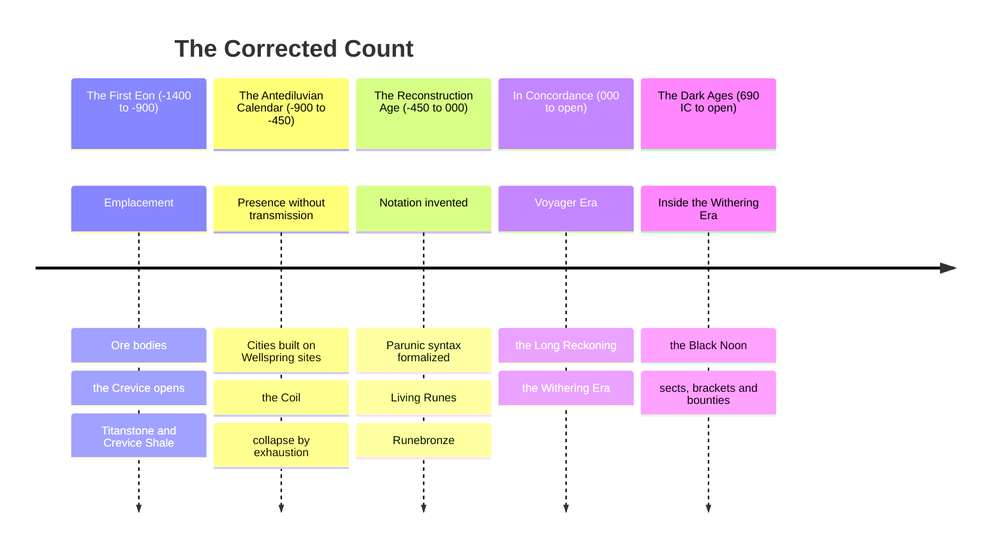
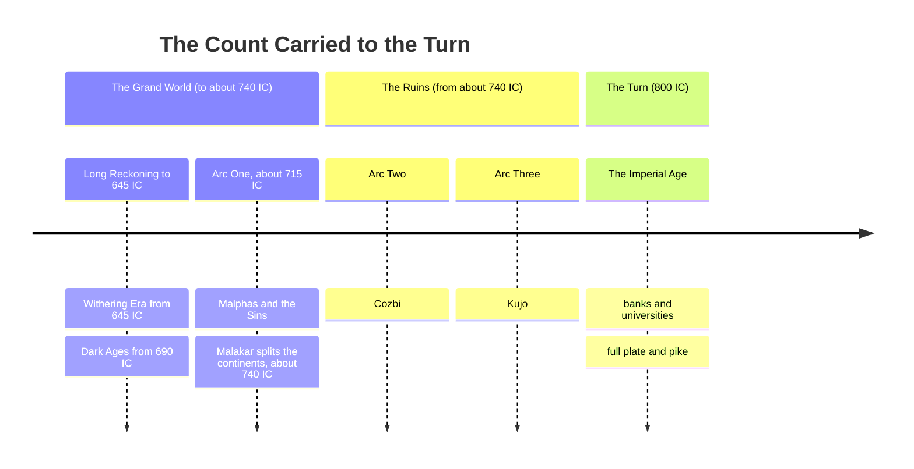

# The Concordance of Ages

*The Fixing of the Count, in Four Ages and One Continuous Reckoning*

At the midsummer brackets of Year 690, at Ironlink in the western quarter, forty thousand people in yellow awnings and sect colors had paid to watch Sister Perpetua Lunt of the Greenmantles fight Ragnall Oxblood of the Saltmarket Reds, and the Guild of Measurewrights had sold most of them an almanac promising that the moon would cross the sun at the fourth bell. It came at the third. Shiro slid over the noon with Lunt's knee on Oxblood's breastbone, the sky went the blue-black of a mussel shell, the sausage-sellers' fires jumped up orange all round the bowl, and for four minutes the only thing anyone could see on the sand was two aura coats (the constant skin of colored light any trained fighter wears), hers the color of a bruised plum and his a screaming marigold, going at each other in the dark.

The two coats met with a ring that every soul in the bowl felt in the back teeth, and forty thousand throats answered it. Lunt broke his jaw in the blackest part of the eclipse, Oxblood broke her wrist and three of her fingers with what remained of his interest in the matter, and eleven people died on the south stair trying to get out from under a sky nobody had told them to expect at that hour. The bookies paid on neither fighter, on the grounds that nobody could swear to the finish. A hedge-minstrel named Tam Lackpenny was singing about it by nightfall, *the dark age came at noon and the odds were four to one*, and his song got the bell, the winner and the number of dragons wrong and traveled faster than the news. Measurewright Ottoline Wray, whose sums the almanac carried in every hand-copied edition, spent the remaining thirty years of her life arguing that the moon had been early.

So the age got its name from a fight, a blunder and a bad song, and the Guild, which dates an age from its first witnessed year, found that it had supplied its own rule with forty thousand witnesses. I am told the Division tried for a decade to call those years something else.

I keep the open shelf's copy of the instrument below, and my copy has been wet twice and on fire once. Everything down to the seal is the Guild's, sealed in Year 715, and its *now* is that morning: the Dark Ages twenty-five years old, the Withering seventy, and one unbroken land under everybody's boots. I have left its *now* alone, because the rest of these shelves stand in that same year and a reader ought to stand there with them. What the Guild could not know when it pressed the wax sits under the seal in Section VI, in my hand, and I write it in the last winter before the turn of the century. Measurewrights will tell you the hand is careless. They are welcome to come and copy it themselves.

> Prepared by the Guild of Measurewrights under the Hexagonal Oath, at the standing request of the Research and Archives Division, and sealed in the Archives Eternal beneath the Council Spire of the Concord Citadel. Year 715 In Concordance, Withering Era, the twenty-fifth year of the Dark Ages.
> 
> This instrument supersedes every register preceding it. The Guild has been asked for a count that a surveyor, a magistrate, and a bloodline claimant can all use without translation, and has produced one.

---

## I. The Rule of the Count

One count runs in both directions from a single hinge, and no other count is recognized anywhere under Accord writ.

The hinge is the sealing of the Concord Codex in the Concord Lattice. The Accord names that **Year Zero** and the Guild accepts it, less for its significance than for its witnesses. Four archives attest the same season independently, and a calendar wants a witnessed date more than an important one.

Years after the hinge are notated plainly and carry the mark IC, read **In Concordance**. Years before it carry the negative and are read as distance backward, so that −450 stands four hundred and fifty years before the Codex was sealed. The whole of reckoned history runs from **−1,400 to the present**, which is two thousand one hundred and fifteen years, and the Guild states plainly that this is a shorter history than the Archives has been in the habit of claiming.

> The longer figures in circulation, the thirty thousand and the twelve thousand and the twenty-five thousand, receive no reduced form. **They are withdrawn.** They originate in a single stratigraphic method the Guild has tested and found to count seasonal ash layers as annual ones, at a Wellspring site where the ash falls four times a year. The error compounds by a factor near forty across the whole depth of the section, and every figure derived from that method carries it.
>
> The Guild has been asked whether this was known before now and has answered that it was suspected, and that the suspicion was inconvenient.

The consequence is a nearer world, in which a bloodline can be traced, a grudge can be inherited by someone who remembers its cause, and a long-lived person can have stood in more than one age and be asked what it was like. The Guild regards that as the count doing its job.

---

## II. The Four Ages

### The First Eon

**Span** · −1,400 to −900. Five hundred years.

**Character** · The emplacement. Ore bodies, the northern shield, the flood-basalt province, the ophiolite belt, the Crevice.

**Close** · No catastrophe. The Eon ends where the first kept record begins, and the boundary is a fact about writing rather than about the world.

Everything the four quarters have ever dug out of the ground was put there in this age, and nothing has been added since. **Skill compounds. Ore does not.** That one asymmetry has governed every economy that followed and will govern the next, and it is the reason the Old World is the first civilization able to see the bottom of the thing it stands on.

| First Eon material | Standing |
|---|---|
| **Titanstone** | The shattered remains of slumbering [[Cosmology & Metaphysics/Faith and the Powers Above/The Fourteen Titans/The Fourteen Titans#World Spirits|World Spirits]]. Near-immortal in density, carrying a metaphysical weight sufficient that a cracked block takes a city down with it. It is found rather than quarried. |
| **Crevice Shale** | Fractures nearby Realm law. Forbidden to move, hold, or trade under **Article III of the Concord Codex**, a law about a rock, and the only such law the Accord has ever written. |

The Guild takes no position on the theology of the age and observes only that both materials behave as though something decided their properties. That is a statement about behavior and carries no claim about intent.

### The Antediluvian Calendar

**Span** · −900 to −450. Four hundred and fifty years.

**Character** · Presence without transmission. Enormous individual capability, no conduit, no storage, no notation.

**Close** · Collapse by exhaustion, repeated across unconnected cities that had no means of warning one another.

The Antediluvians could do extraordinary things with Essence and could not move it one pace. That is the whole of their technology and the whole of their fate. A practitioner pulls Aether out of the ground and air around them, refines it in the Soul Crystal into Essence, and drives it out through the Shell, and where they stand decides how fast they fill. Aether comes in kinds that work on the Crystal differently, and those kinds are the Wellsprings, sixty of them and fixed, each a source of power and each also an alchemical principle and a spiritual transformation. A Wellspring has sites where its Aether pools, and common speech calls such a site a Core. A person standing inside a Core's field can work with it, and a person outside that field cannot, so a civilization that wants a great many people working must put a great many people on top of the source.

They built on Wellspring sites, directly on top of them, with the foundation courses sunk **into the pooled ground itself**. Every excavated site shares the same plan, a dense settlement wrapped concentrically around a source with the most valuable structures innermost, which reads to a modern surveyor exactly like a diagram of field strength and was almost certainly arrived at by trial.

> A body is the only Essence conduit that walks. Lacking any means of sending Essence anywhere, the Antediluvians moved practitioners instead, taken from wherever they were found and held at the works that needed them until they were used up. Surviving tablets record throughput, loss, and replacement rate in the same columns as grain.
>
> The Accord treats this as a moral fact. It was a technical one as well, and the two readings do not compete.

#### The Coil

The most important instrument in the modern economy was built to sort people.

Hauling a practitioner across three hundred leagues is expensive, and hauling one who turns out to be useless is a loss the ledger notices. So somebody wound a conductor into a ring and discovered that it answers measurably to the Essence character of whatever is set inside it, and for the first time in history a question that had been a matter of somebody's judgment produced a number instead.

Every holding coil in every Accord assay house is a refinement of that ring. The trade in Holding-grade material, which is the trade the modern world runs on, descends without a break from an instrument built to decide which people were worth the journey. *The Guild has included this in the plain register rather than the appendices, over the Research Division's written objection.*

> **A distinction the trade literature blurs and the Guild does not.** The **principle** is Antediluvian and among the oldest instruments in the record. The **coil** is younger. A ring that answers to what is set inside it tells one reader something; **a coil that gives the same number in two kingdoms is a different device entirely**, and that device is a Voyager Era product of shared units, sealed reference standards and annual calibration.
>
> *Fourteen hundred years separate the two, and everything the Accord's legitimacy rests on lives in the gap.*

#### The Collapse

When a Core began to fail, an Antediluvian city could not answer by leaving. It could only answer by pulling harder on the source that was already failing, and pulling harder meant bringing in more bodies. The archaeological record of four and a half centuries is that loop running to completion, in a dozen places, none of which knew the others existed.

> **What the Guild records and does not interpret.** A site pulled from without reciprocity goes past thinning. **The pooled Aether stops recognizing visitors and begins taking from them**, which the modern register calls a site running under Obsession Force and treats as a hazard classification rather than a history.
>
> Every excavated Antediluvian settlement sits on a source that was pulled to exhaustion by a population that had no other option. *The Guild has surveyed nine of them. It has recorded the density readings and declined to publish a finding on what the sites are now doing, on the grounds that the finding would be a theological claim and the Guild does not make those.*
>
> **The exclusion perimeters around all nine were set by the Enforcement Division and have never been reduced.**

*The Guild asks that this paragraph be read alongside Section III.*

### The Reconstruction Age

**Span** · −450 to 000. Four hundred and fifty years.

**Character** · Notation. The invention of writing Essence down, and everything that follows from it.

**Close** · The sealing of the Concord Codex, which is Year Zero.

The Age produced no machine and contains the largest single break in the history of making. Parunic syntax was formalized out of whatever the Antediluvians had been doing by feel, glyphs were assigned stable meanings, and the combinations were cataloged. **Kessian Yorul** cut the first Living Runes into bone, inscriptions that feed on the bearer's own circulation. **Mnirah Valein** codified the Twelve Stages of Spirit Infusion and, in doing so, established that capability could be graded, taught, and required before permission was granted, which is the ancestor of every guild license now in force.

> Before notation, an effect required a practitioner standing in the room. After notation, an effect could be laid into a substrate and left there, and it would keep working when nobody was watching.
> 
> Every array, every ward-stone, every mine-lift and draught-fan, every lamp a warden has set burning and walked away from descends from that sentence. The years In Concordance did not invent the array. They inherited the idea and eventually had the money to build one at scale.

Making in this age is bloomery iron, charcoal, and the first material in history designed to hold an inscription rather than merely tolerate one. **Runebronze** is melt-forged with minor glyphs, durable under basic enchantment, and still carried by minor guild knight orders. Somebody worked out that the glyph could go in during the melt instead of after the cooling, and the entire subsequent tradition of Holding-grade manufacture is a footnote to that discovery.

The Age's doctrine, that Wellsprings must be respected rather than exploited, is read by the Archives as wisdom learned from the Antediluvian collapse. The Guild records a less flattering reading and does not endorse it: a civilization with no conduit and no pump cannot exploit a Wellspring at scale even when it wishes to, and a virtue that costs nothing to hold is difficult to tell apart from an incapacity that has been given a name. **The doctrine was tested when the capacity arrived. It did not survive the test.**

### In Concordance

**Span** · 000 to open. Seven hundred and fifteen years and running.

**Character** · One continuous count, unbroken, never reset. The first age to know its own date the whole way through.

**Close** · None. The count has not closed and the Guild declines to say when it will.

The significance of the years In Concordance is that they can be audited. Every age before them must be assembled from ash layers, foundation courses, and the arguments of dead clerks. These years have receipts. The Accord's power rests less on its enforcement divisions than on the fact that it can state what happened and prove the date, and every rival authority in the four quarters has had to argue against a ledger rather than against a story.

The count divides into three eras, and the third of them is the present era. The Guild stresses that these are **eras of one count**, none of them an age in itself, since the count does not break, the grammar does not break, and the institution sealed at Year Zero is the institution sitting in the Council Spire this morning.

#### The Voyager Era · 000 to 070 IC

The sealing of the Codex and the opening of the routes, and the two are the same event viewed from different divisions.

The first decades built nothing. They established shared units, sanctioned notation, and the first assay houses, which is to say they established that two people in different kingdoms could specify the same thing and mean it. Every history of the era skips this and every history of the era is wrong to. The Concord Codex, the Lattice, the Divisions, the Tiered Path, and the first nine Concord Gates all date to this seventy-year window, and the documents bearing the stamp of Year 013 and Year 027 In Concordance are correct as written and require no correction.

The enabling technology of the expansion was **the chart and not the ship**. What the routes brought back broke the money. Eastern placer gold is won by hand from black-sand river bars with no permission required from anybody, which meant bullion arrived in the western quarter in quantities no mint controlled and no crown could meter. Prices roughly doubled within a generation. The western guilds spent thirty years blaming hoarding, foreign merchants, bad harvests, and moral decline, and then a Babylan theorist observed that when the quantity of money rises faster than the quantity of goods the money is worth less, which is not a moral fact and cannot be legislated against.

Wage earners lost. Wages are customary and adjust slowly, prices are not and do not. *The Voyager Era is commemorated with a public holiday in four kingdoms and the holiday commemorates the charts.*

#### The Long Reckoning · 070 to 645 IC

Five hundred and seventy-five years, the body of the count, and the era in which the ceilings fell. They fell in an order nobody planned, and each solution created the problem the next answered.

| Ceiling | Held at | Fell |
|---|---|---|
| **Water** | Sixty fathoms below the adit line, held everywhere, under every flag, in every age preceding | Year 90 to 130, to Phreatis-fed lift arrays |
| **Air** | Depth kills by atmosphere before it kills by roof | Year 150 to 175, to worked draught arrays, funded by the bodies the pumps had already produced |
| **Heat** | Charcoal will not liquefy iron, and had not, in any age | Year 260 to 310, to Ignivale and Pyraeon forge-arrays, by way of plain thermodynamics. Everything above the fourth tier of making comes out of that window, Aethersteel first among it |
| **Haulage** | Rock is heavy and ropes have a limit | **Never fell.** Was merely lied to, by Weight Ablation glyphwork that misreports the load to the rope rather than lightening it. The industry is built around that lie rather than through it |

What the era built was a dependency. A pumped shaft must be pumped forever, since the array does not stop when the ore stops and the water returns at the rate it always wanted to the moment the array does. An array wants feeding, and the feeding is done by array-keepers, practitioners on a shift who pull from the ground under the pit head, refine it and drive it into the contacts, and who are paid by the hour and may decline to come in. A modern western pit is a permanent argument with the water table conducted at a fixed hourly cost, and the west lost the ability to walk away from that argument some time around Year 140 without noticing it had happened.

> By the close of the era the western quarter had arranged its industry and a substantial part of its food supply so that a sustained Essence shortage becomes a **mass drowning within ninety hours** and a **famine within a season**. It did this incrementally, profitably, and with no individual decision anywhere in the chain that looks wrong on its own terms.

#### The Withering Era · 645 IC to open

This era is the bill, seventy years of it so far.

The ambient Wellspring density of the western quarter (Aetheric Density, in the scholar's term: how much Aether the ground and air hold for anyone to pull) began to fall measurably around Year 645 and has fallen every year since. The Research Division describes the phenomenon as *contested*. Every pump-master between Ironlink and the Greaves districts describes it as *Tuesday*. Every bracket fighter in the same country calls it *the thin*, and will tell you loudly and at length how much longer it takes to fill back up between bouts than it did for his teacher, and how an eastern fighter on his rich home ground is practically cheating.

Nothing about the Withering resembles the collapse that closed the Antediluvian Calendar, which is why it took a generation to name. There is no plague, no war of sufficient scale, no visible catastrophe anyone can point at. The great houses buy Essence supply the way an army buys grain (Core-keepers' contracts, array crews on retainer, sealed Holding vessels on mule-back), a bad year in supply closes shafts still full of ore, and the price of certainty has risen in each of seventy consecutive years without a single year in which anybody could say what had specifically gone wrong.

A civilization that feeds itself through an Essence dependency has arranged for a Wellspring failure to become a famine. The Codex made that doctrine at its sealing and the western quarter has spent seven centuries quietly outrunning it.

#### The Dark Ages · 690 IC to open

The Dark Ages are an age inside an era, twenty-five years old at this sealing.

**The Dark Ages** is the street's name for the years since the Black Noon of 690 IC, when the moon crossed the sun over the Ironlink brackets, and the Guild has entered it here because every quarter reads it without translation. The present year, 715 IC, is its twenty-fifth. It rises inside the Withering Era and runs alongside it, so that every date written this morning belongs to both at once. The four ages above divide reckoned time between them. The Dark Ages name what the world has come to live in, and they overlap the era they rose in.

**The name flatters nobody and describes very little.** The Archives holds that *dark* refers to the state of the records, the wars having eaten a good many of them. The Sohai holds that it refers to the state of the reading. Tam Lackpenny's heirs hold that it refers to the eclipse, and collect on the song. No visitor to a market day would guess any of it. These are the loudest years the Guild has on file: painted shields and sect banners on every bridge, crowds three deep at any bracket worth the entry, gold-leafed temples older than the count with a food-stall against every wall, lamps in amber and rose behind salt-glass, and more people who can do something impossible than at any point since the count began.

**Practitioners are common** and everyone can read the ranks: outer disciple, inner disciple, core disciple, elder in the sects, the Guild's own titles in the halls, Stage brackets at every fair. A school runs like a town's great love and greatest liability, with its colors, its songs, its grudges, and a house style a child can spot at fifty paces. **Small powers are everywhere** and they are trades, done by living hands for money: the hedge-worker who takes off a wart for a copper and will put it back for two, the ward-cutter, the Guild craftsman bragging about his mark over a contraption that has twice burned down his own shop. Any of them may overcharge, strike or tell you to find someone else. **Fame moves on foot.** Heralds cry the news at the crossroads, minstrels carry it further and wrong, lords post bounties on hand-copied bills nailed to doors, and bookies quote odds on all of it. What is built and carried is what a smith and a guild hall can make, and the road, the ship, the rider and the beacon are as fast as anything gets. The cheapest way to end a high-Stage fighter in a closed room remains a crossbow bolt from a man the fighter has not looked at, and every great house in the four quarters keeps a few such men.

*Nothing before 690 IC belongs to the Dark Ages. The Guild dates an age from its first witnessed year and has done so here, and it records that the age is young.*

---

## III. The Repeating Figure

*The Guild has been instructed to keep its findings to matters of date and has requested one exception, which the Research Division granted on condition that it be marked as commentary. It is marked.*

> The Antediluvian answer to a failing Wellspring site was to pull harder on the site that was failing, and to bring in more bodies to do the pulling. The current western answer is to contract for supply from further away, at a higher price, on a longer term.
>
> These are the same answer with a longer haul, and the second is being given by an institution that possesses a complete written record of what the first one cost.

The Guild does not predict. It observes that in the compressed count, the distance between the height of the Antediluvian Calendar and the present day is fourteen hundred years, that this is a distance a Wellspring remembers, and that several persons now living were born before the first pump-master noticed the fall.

---

## IV. The Concordance in Full

| Age | Opens | Closes | Span and Notation |
|---|---|---|---|
| **The First Eon** | −1,400 | −900 | 500 years · ⟨FE⟩ |
| **The Antediluvian Calendar** | −900 | −450 | 450 years · AC |
| **The Reconstruction Age** | −450 | 000 | 450 years · RA |
| **In Concordance** | 000 | open | 715 years and running · IC |
| · the Voyager Era | 000 IC | 070 IC | 70 years · founding and expansion |
| · the Long Reckoning | 070 IC | 645 IC | 575 years · the ceilings fall |
| · the Withering Era | 645 IC | open | 70 years and running · the present era |
| **The Dark Ages** | 690 IC | open | 25 years and running · the present age, inside the Withering Era |

*The instrument records four ages, three eras within the fourth, and the Dark Ages rising inside the last of them: one count, from −1,400 to the present, with no interregnum, no reset, and no gap in which a claim may be hidden.*

---

## V. What Remains Open

The Guild closes the count and records three matters it cannot close, on the standing principle that a discrepancy papered over is a discrepancy that will be found later by somebody with less patience.

**The Antediluvian founding** · They kept a calendar and counted forward in it from a founding the Guild cannot locate, so their internal dates cannot be converted and appear here in the count by stratigraphy alone. Somewhere under the ash there is a Year One that would fix four and a half centuries to the season.

**The First Eon's opening** · The figure of −1,400 marks the oldest datable emplacement and not the beginning of the world. What lies before it is undated and the Guild declines to guess at its depth.

**The Withering's mechanism** · The Guild can state the rate to three places and has done so annually for seventy years. It cannot state the cause, and will not manufacture one to satisfy a Division that has asked four times for better news.

---

> *Attested and sealed. Guild of Measurewrights, under the Hexagonal Oath, in the Archives Eternal beneath the Council Spire. Year 715 In Concordance, Withering Era, the twenty-fifth year of the Dark Ages. Every register preceding this instrument is withdrawn.*

---

## VI. Below the Seal: The Count Carried to the Turn

*Added in a later hand and a different ink. The Guild has not attested it and has twice asked for it to be scraped off.*

The Guild wrote *open* in three cells of that table and it was right to. I can fill them, more or less, from the last winter before the turn, and I will do it as a table first, since the sealers would want that, and argue afterward.

**Not one year number moves.** Year Zero is Year Zero, the Long Reckoning still runs 070 to 645, the Withering still opens at 645, the Black Noon is still 690 and the sealing above is still 715. Every date on every shelf that conforms to this instrument stays where it stands. What the count gained after the seal is what it could not have known, and it has kept running straight through all of it, which is the one boast of the Guild's I will repeat without a smile.

| Stretch | Years | What it is |
|---|---|---|
| **The Grand World** | the whole count, from −1,400 to the split, about 740 IC | The one body of land the whole of this instrument is written on. Its four quarters are quarters of a single continent with isles off its shores, and a carter could take salt from the northern basins to the warm southern marches and never pay a ferryman. Nobody living in it needed the name. It was given afterward, the way you name a house once it has burned |
| **The Dark Ages** | 690 IC to the turn, 800 IC | One hundred and ten years, inside the Withering Era. The storyline of these shelves runs in its last eighty-five |
| · Arc One, Malphas and the Sins | about 715 IC to the split, about 740 IC | In the Grand World |
| · the split | about 740 IC, near the close of Arc One | Malakar splits the continents |
| · Arc Two, Cozbi | from the split onward | In the ruins |
| · Arc Three, Kujo | onward to the turn, 800 IC | The arc that runs out the century |
| **The Imperial Age** | from the turn, 800 IC | A Renaissance, right after the Dark Ages: banks and merchant houses, universities and anatomists, and full plate, pike and condottieri (captains who sell a whole company's fighting by contract) |

**Arc** is the minstrels' word, a cycle of songs long enough to fill one winter, and I use it because the singers cut the age into three of them before any scholar got round to it. The joints between the second and the third are theirs, and the singers do not agree, so I have left that boundary without a year.

**The split has no sealed date.** I give about 740 because that is the middle of the argument. One Division clerk has 738 from a run of tax receipts, a Marrowkin hold has an entry number that converts to 741 if you accept the conversion, and every water clock that might have settled it stopped that day. Before it a person could walk the length of the world in one pair of boots, and after it that person wanted a boat. The count survived because a count is a very light thing to carry.

**Muken Moto** belongs to the generation born before the split, and he lives through it. The ballads have the rest of him wrong in at least four keys, and most of the people those ballads are about are still alive at this end of the century to complain.

**The Moto read it coming, and I am obliged to record the complication.** The [[Factions, Bloodlines & Institutions/Houses and Bloodlines/The Archaic Bloodlines/The Moto Bloodline/The Long Reading — Moto Ancient History|Long Reading]] has the house reading the split long before it arrived, a reading that gave pressure and vector and no hour, and it has the white shelf at the land's western edge going under a first blow while the rest of the body held. I place that breaking, with the Refusal and the Stay that answered it, at about 310 IC, on the Holy Sea of Alabaster's own four centuries of testimony counted back from the sealing above. The Moto registers call that first blow the split because to them the whole thing was one event with a long middle. Two Measurewrights I have read file it as an unrelated coastal collapse. I hold it was the same hand's first attempt, and I expect to be argued with.

**The old works sit off this table altogether.** The dead battlefields, the relics people kill for and the old beings who remember come down from the Great Spirit War and the days of the Physical Epochs, when Bara, Ashura and Aegor walked in human form, and the Guild's own rule keeps Epoch figures off the count. See the [[Cosmology & Metaphysics/Ages and Reckoning/Errata to the Received Registers|Errata]], Section II. A surveyor who tells you what year such a field was fought has sold you something.

*The ink is nearly out and the bank on the corner has started keeping a light on after dark, which I am told is the future. Read the instrument above as it was written, and let the morning of Year 715 be the morning.*
