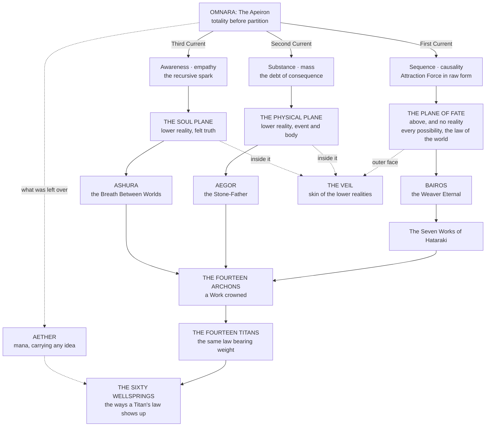

![[Assets/Paintings/cosmology.webp]]

# Cosmology & Metaphysics

> Two realities and the thing above them that is not one. Fourteen crowned ideas administering the principles that make the planes legible to each other. One skin around the lower realities, where the laws of all three become negotiable. And, running underneath the whole architecture, a count that was wrong by a factor near forty until somebody checked the ash.
>
> *"Reality is the shape that possibility chooses to wear for a little while. The Plane of Fate is the wardrobe."*
>
> *Fragment of the Lattice of Names*

Every midsummer the Dyers of Wenlock Cross play the Making of the World off a wagon in the cloth market, and for two centuries they played it one way. The whole guild holds up a single bolt of undyed linen forty ells long, which is Omnara. Three men in masks tear it lengthwise before the crowd, and the apprentices run the strips through open vats of saffron, madder and woad and come pelting back through the front rows dripping gold for Bairos, red for Aegor and blue for Ashura. In the year before the Concordance was sealed, the pageant-master climbed up in his robe of fourteen colors to give the closing line, "Thirty thousand years of the kings of the Realms," and a Guild surveyor named Lambin Scrope, three cups into the free barrel and still carrying a pail of ash from his morning's work, stood up on a bench and bawled that the man had counted the ash wrong. The madder apprentices got to him first. He went through the woad vat next, and then the pail went over the Provost's wife, and the fight took out the wagon, nine stalls and a good part of Saint's Row. Scrope attended the hearing blue to the ears. The Dyers won the price of the linen and the Guild paid it without complaint, then sealed his figure into the count that autumn. The Dyers still say thirty thousand, louder than ever, and the Guild has ruled that they may, because a pageant is a myth, and this section is about keeping a myth and a measurement on separate shelves.

Everything below is the loudest and oldest argument in the library, and I am very fond of it. Read it knowing that scholars have an account of everything, the gods included, that some of those accounts are wrong, and that a Measurewright will happily fight you about which.

---

## The Architecture

Everything in this section descends from a single event that no surviving record explains. Before it there was **Omnara**, the state of totality before totality required compartments. After it there were three currents, and from the three currents three planes, and from the three planes three sovereign intelligences, and from the tension between those three the **Fourteen Archons** condensed into conceptual sovereignty. Bara's Works came first and the Archons are those Works crowned. The **Titans** descend from the Archons, the same laws set down to bear weight, and they are the Wellsprings themselves, of which the Sixty are the manifestations a soul can use. Whatever was left of Omnara undivided is **Aether**, the medium that carries it all. If you want that walked in order, one step at a time, read [[Cosmology & Metaphysics/From Omnara to a Blow|From Omnara to a Blow]] first.

The three are not three of a kind, and any diagram that draws them as three equal floors of one house is wrong. The **Physical Plane** is Physical Reality, Aegor's, where truth becomes event, body, ruin, and mountain range. The **Soul Plane** is Spiritual Reality, Ashura's, the stratum through which abstract law becomes a soul's felt truth. Those two are the lower realities, neither of them over the other, and everything that is, is in one or both. The **Plane of Fate**, Bara's, is above them, and a careful Measurewright will stop you for calling it a reality at all. It is everything that flows, every possibility, idea and concept, anything that can happen in the two below before it has, the lattice all of it hangs from and the law and construction of the world, and "plane" is a courtesy. Wherever one plane's law borders another's, a transition zone must exist, and that transition zone is the **Veil**, the skin of the lower realities: the two of them and every realm lie inside it, its inner fold runs between them, and its outer face is where they meet Fate.

Most if not all of the Archons are Sovereign on all three planes, and on the Plane of Fate they are the laws as well as the powers. Some are deemed greater than others, and **Uurgath and Urion** are unparalleled in Fate, because what they are cannot be conceived. Bara stands above all fourteen, so they are the most powerful things that still act up there and no more than that. Each of the [[The Magic System/The Soul and the Climb/The Three Paths Routing, Recognition and the Gate|three Paths]] is a soul's way of reaching one of the three: Body the Physical, Spirit the Soul Plane, Fate the thing above. Being above makes Fate the hardest of the roads and in no way the best of them.

> **The hierarchy of law.** Fate and the Works stand over everything below: the Plane of Fate is the law and construction of the world, and the Works are its first grammar, so vows, blessings and Hataraki answer to nothing else on this list. Under them run three domains of authority, which are not ranks. Titanic Law governs the geologic and cosmic architecture of the Realms. **Archonic Law** governs the conceptual forces that give physical and energetic phenomena their meaning. **Wellspring Law** governs the behavior of Aether and of the Essence a soul refines from it: Aether comes in types that affect the Soul Crystal differently, those types are the sixty Wellsprings, and each is a source of power that also stands for an alchemical principle and a spiritual transformation, and is a lens a soul can base its tempering on. All spells, Domains, Soul Crystal mutations, Wellspring temperings, and godlike abilities must rest on one of these three strata, and every one of the three rests on Fate. No magic exists outside the lattice Omnara's Division created.

---

## The Count

The cosmological record and the historical record are two different conversations, and the Guild of Measurewrights has ruled formally that they are not to be reconciled with one another.

The **Epochs** are cosmological. Their durations survive in figures running to the tens and hundreds of thousands, and the Guild has examined every one of those figures and found that not one derives from a count. No calendar existed. No observer stood outside an Epoch to mark its passage. The **Ages** are historical, counted and attested by physical evidence, and the whole of them runs from Year −1,400 to the present. The present, on every page of these shelves, is Year 715 In Concordance, the twenty-fifth year of the Dark Ages, with one unbroken land under everybody's boots.

A document giving both is giving a myth and a measurement, and expects the reader to know which is which.
> Every claim resting on antiquity is worth less than it was before the Concordance was sealed. A house that held title by right of thirty thousand years now holds it by right of six hundred. In law the title has lost nothing. It has lost a great deal in the only currency such claims actually trade in.

---

## The Registers

Three institutional voices produce the material in this section, and they do not sound alike. Reading them correctly means knowing which one is speaking.

| Register | Voice | Speaks to |
|---|---|---|
| **The Codex of Three Planes** | Liturgical and mythic. Divine Edicts quoted in the first person. Archivists naming the unnameable with visible reluctance. | Omnara, the Division, the Epochs, the Archons, Archonic Magic |
| **Aetherica literature** | Structural and clinical. Temperance gates, thickness gradients, failure modes stated as conditions rather than as omens. | The Veil, Bifold Perception, Soul Drift, rupture containment |
| **The Guild of Measurewrights** | Dry, adversarial, allergic to flattery. Records what the correction costs and declines to manufacture a mechanism it cannot evidence. | The Concordance, the Errata, the Four Ceilings |

---

## Entries

> **The reading order.** Ten documents. The path starts with the whole chain on one page, runs inward from the totality that broke, out to the beings that came of it, and then to the two corrections the Guild made to the record everyone had been reading.
>
> **1 · From Omnara to a Blow:** the whole chain in order, in plain words, for anyone new.
>
> **2 · Omnara and the Division:** the totality before partition, the event no surviving record explains, and what it left over.
>
> **3 · The Three Epochs:** the cosmological account, the soul's three layers, and how they come apart. Myth, and known to be.
>
> **4 · The Fourteen Archons:** the crowned ideas administering the principles that make the planes legible to one another.
>
> **5 · The Fourteen Titans:** those same principles bearing weight. Titanic Law, the Wellsprings at full scale, and the World Spirits.
>
> **6 · The Veil:** the skin of the lower realities, with the realms placed inside it. **The single most cross-referenced page in the wiki.**
>
> **7 · The Celestial Host:** the beings Law folded in order to witness itself.
>
> **8 · The Concordance of Ages:** the count, corrected. Read this before trusting any date anywhere in the wiki.
>
> **9 · Errata to the Received Registers:** what the correction cost, entry by entry.
>
> **10 · The Four Ceilings:** why the world's making sits where it sits, and what removed the limits.
>
> **The two conversations.** The **Epochs** are cosmological: their durations run to the hundreds of thousands and not one of them derives from a count. The **Ages** are historical, attested by physical evidence, and run from Year −1,400 to the present. *A document giving both is giving a myth and a measurement, and expects the reader to know which is which.*
*The groupings below are the filing. The order above is the path. The pages also sit on three shelves of their own: [[Cosmology & Metaphysics/The Making of the World/The Making of the World|The Making of the World]], [[Cosmology & Metaphysics/Faith and the Powers Above/Faith and the Powers Above|Faith and the Powers Above]] and [[Cosmology & Metaphysics/Ages and Reckoning/Ages and Reckoning|Ages and Reckoning]]. [[The Disciplines/Schools and Bloodline Arts/Null-Light|Null-Light]], Ashura's instrument and the Yukari way of knowing a thing by a light that never touches it, is shelved with the bloodline arts beside Hataraki. Back to [[Start Here]].*

### I · The Architecture

The cosmological spine, in the order it was made: the totality before partition, the three intelligences that came out of its breaking, the fourteen crowned ideas that administer the result, the load-bearing laws that came down from them, the skin around all of it, the beings Law folded in order to witness itself, and the one surviving account of what the far side looks like from inside.
- [[Cosmology & Metaphysics/From Omnara to a Blow]]
- [[Cosmology & Metaphysics/The Making of the World/Omnara and the Division]]
- [[Cosmology & Metaphysics/The Making of the World/The Three Epochs]]
- [[Cosmology & Metaphysics/Faith and the Powers Above/The Fourteen Archons/The Fourteen Archons]]
- [[Cosmology & Metaphysics/Faith and the Powers Above/The Fourteen Titans/The Fourteen Titans]]
- [[Cosmology & Metaphysics/The Making of the World/The Veil]]
- [[Cosmology & Metaphysics/Faith and the Powers Above/The Celestial Host]]

### II · The Count

*The correction, what it cost, and what it explains. The Measurewrights speaking, and they do not sound like the other two registers.*
- [[Cosmology & Metaphysics/Ages and Reckoning/The Concordance of Ages]]
- [[Cosmology & Metaphysics/Ages and Reckoning/Errata to the Received Registers]]
- [[Cosmology & Metaphysics/Ages and Reckoning/The Four Ceilings]]
- [[Cosmology & Metaphysics/Ages and Reckoning/The Sky, the Hour and the Year]]
- [[Cosmology & Metaphysics/Faith and the Powers Above/The Faiths of the Four Quarters]]
> **Time, and what people do about the owners.** Two additions sit under this section.
>
> **The Sky, the Hour and the Year** sets out the world's own sky above the plain calendar everyone already keeps. One sun, one moon whose twenty-eight-day cycle keeps no step with the months, five wanderers and a pole star, and a year of twelve months and seven-day weeks with a day of **twenty-four hours**, kept on the great water clock at Sealhall and carried outward by relay rider, sealed sand-glass and the beacon line. Only the year counts are the world's own. Every fourth year February takes a twenty-ninth day that belongs to no Archon, **Munahi**, and on it no Work falls due, nothing can be entered and no instrument binds: the day the law sleeps and Fate does not, so a vow spoken on it still holds.
>
> **The Faiths of the Four Quarters** places Sohai and Sancta Lux against three others, two of which go about their business without being called religions: the Marrowkin **Tally**, the Kharven **Sky**, and the **Current**, the folk Wellspring practice that is the largest faith by headcount and has no name for itself. Every entry answers the same six questions, and the last of them is what the faith is wrong about. Cults are handled separately, by how they recruit and how they eat.
