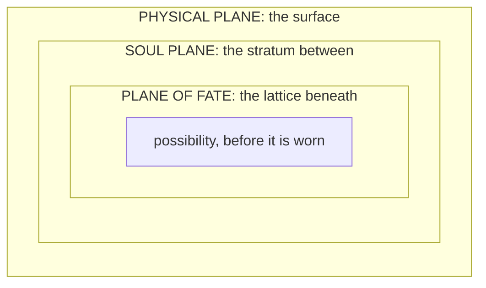

# Omnara and the Division

> *"The Apeiron does not remember the Division, for it was not conscious in any way the post-Division cosmos would recognize. To remember requires sequence. Omnara contained all sequences simultaneously, and therefore remembered nothing, and therefore forgot nothing, and therefore was everything that memory and forgetting would later describe."*
>
> *Lattice of Names, Fragment Zero*

On the morning of the spring equinox, three hundred singers of the Sect of the One Note climbed the green hill above Ossery in robes of cloth-of-gold, with some four thousand people behind them carrying picnics, to sing the world back to where it started. Their abbess, Iseult Lisle, had spent thirty years on the theory: a chord holding every pitch at once, in which no voice could be told from any other, would be the Apeiron itself made audible, and whoever stood inside it would know what the cosmos knew before it had parts. At sunrise she brought her hand down. Three hundred coats came up at once, ember and teal and arterial red and every other hue the sect had recruited, and as the chord closed the colors ran together up the hillside into a white that no Family owns and nobody present could look at. The noise had no pitch at all. People a mile off said it was like standing inside every bell foundry in the world. Glass broke in three parishes, the cows in the low meadow dropped their calves early, the river at Ossery stood up in small square waves, and thirty-seven of the singers never heard another thing as long as they lived. It lasted until they ran out of breath, which was a little under a minute. The Guild's observer, eating an onion on the far slope with wool in his ears, entered the event as a complete success at producing noise, and added that a totality does not contain partitions and that the abbess had used three hundred of them to build it.

They were wrong in a very grand way, and I love them for it. Every school that has ever gone looking for what came before the first thing has been wrong in some way, and here is what they were all looking for.

---

## Omnara: The Apeiron

### The Formless Totality · The Womb Before Naming

Before causality drew its first breath, before weight existed to anchor thought, before awareness discovered itself in the dark between uncounted infinities, there was Omnara.

Omnara is the name given by the earliest Parunic archivists to the state of absolute undifferentiated unity that preceded all existence. The word itself is borrowed from the Proto-Parunic root **omn**, meaning "completeness without boundary," and **ara**, meaning "womb" or "the place from which emergence is permitted." Together, Omnara translates roughly as **The Womb of All Completion**, a title the archivists used with visible reluctance, aware that naming the unnameable was itself a kind of transgression.
> The archivists refuse Omnara the name of being and the name of force alike. Omnara was the condition of totality before totality required compartments.
Every law that would later govern reality, every Archon that would later embody a principle, every Wellspring that would later pool in the ground of the world and turn a Crystal to its own nature, every soul that would later struggle toward Temperance, all of it existed within Omnara as potential without partition. Fate was not yet separate from Body. Spirit had no boundary against Matter. Attraction and Obsession were the same current flowing in a direction that did not yet exist.

To call Omnara a god would be to diminish it by suggesting it had intention prior to the mechanisms of intention. To call it a place would be to impose space upon something that predated the geometry of placement. Omnara simply was, and within that **was** lay everything the cosmos would ever become, compressed into a singularity of undifferentiated meaning.

---

## The Division

The Division is the cosmological event that ended the Apeiron and birthed the tripartite architecture of existence. No surviving record describes why it occurred. The oldest fragments treat it as an inevitability encoded within Omnara's own totality, with no choice anywhere in it: a unity that contains all possibilities must eventually contain the possibility of its own separation.

*The Measurewrights, who cannot leave anything alone, have an account of their own. Take a pail of very still water on a very cold night, they say, and it can sink well past freezing and stay liquid, perfectly even, with no reason in it to become one thing rather than another, until a single nudge sets the whole pail to ice along the lines the water's own nature allows. They call this the Pail, and they say totality was the pail. The archivists answer that a pail implies a shelf and a nudge implies a neighbor. Neither side has ever given an inch, and the record says nothing either way.*

From Omnara's singularity, three primal currents unfurled, each carrying a distinct axis of what existence would require to function as a coherent system.

### The Three Currents

| Current | What it carried | What rose from it |
|---|---|---|
| **The First Current** | The architecture of sequence, causality, and the permission for events to unfold in ordered relation to one another. This current became **Attraction Force** in its rawest form: the capacity for one thing to recognize another across the void of uncreated space. | **The Plane of Fate** |
| **The Second Current** | Substance, mass, endurance, and the debt of physical consequence. It compacted potential into weight, turning the infinite into the finite, the imagined into the endured. | **The Physical Plane** |
| **The Third Current** | Awareness, empathy, the recursive spark that allows thought to discover itself thinking. It breathed will into matter and choice into destiny. | **The Soul Plane** |

### Nested, Not Stacked

The three planes nest inside one another, and no stair runs between them. The **Plane of Fate** lies deepest, the lattice upon which all possibility rests. The **Soul Plane** lies between, the stratum through which abstract law becomes a soul's felt truth. The **Physical Plane** sits at the surface, where truth becomes event, body, ruin, and mountain range. Only the last two are realities in any careful sense. What lies deepest is everything that flows, every possibility, idea and concept, and "plane" is a courtesy.

> *"Reality is the shape that possibility chooses to wear for a little while. The Plane of Fate is the wardrobe."*
>
> *Fragment of the Lattice of Names*
>
> Wherever distinct planar laws border each other, a transition zone must exist. That transition zone is the **Veil**, a structural necessity generated by the three-plane cosmology rather than a fourth plane in its own right.
