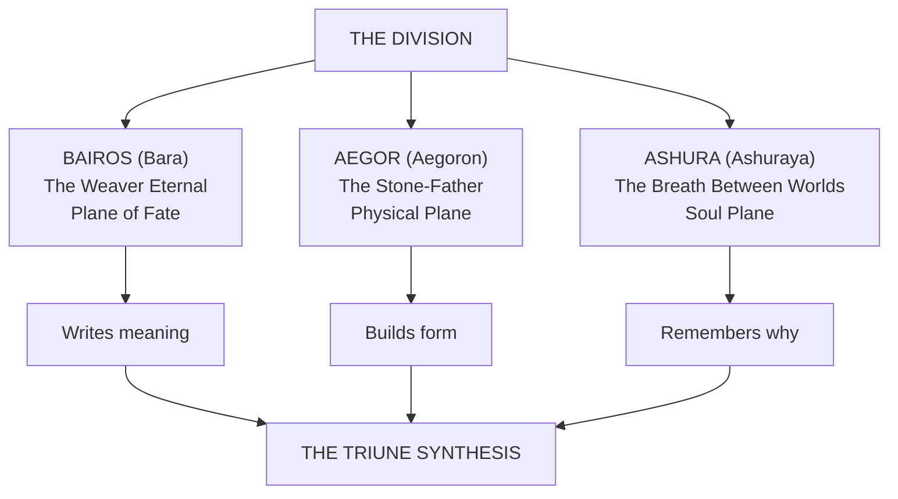

# The Three Epochs

High on Kessel Tor there is a hollow in a basalt face, broad as a threshing floor and whorled from edge to edge, and every child in the district will tell you that it is the print of Aegor's thumb, left where he leaned to get his breath in the days he walked in human form. The Masons of Kessel and the Quarrymen of Stane fought for fifty-two years over the right to cut it. Each midsummer they met on the slope in their colors, ochre sashes against scarlet, first with mallets and then, as the prices of a chip of the Thumb went up among relic-buyers, with hired fighters from the sects down the valley, while the villages sold them beer. It ended on the day a hired man called Wat Greathand, of a good Stage and a bigger opinion, drove his amber-coated fist into the deepest whorl to settle the argument in front of three hundred witnesses. His coat went out. The basalt came up his arm to the shoulder faster than he could shout, with no heat in it and no pain he ever complained of, and he stood there nailed to the mountain for sixteen years, fed by both guilds, cheerful to the end and very good on the subject of guild politics. He is still there, and the arm has since been joined by the rest of him, and people tie ribbons on him for luck with heavy lifting. Neither guild has touched the Thumb since. A Guild surveyor measured it, reported that the whorls match no hand or tool known to him, and declined with some force to say how old it is.

Things like that are why people get careful about the three beings on this page. In the days of the Physical Epochs, Bara, Ashura and Aegor walked in human form, and what is left of those days lies about the world as dead and dangerous battlefields, relics people kill for, and old beings who remember. What they were before they ever put on a body is the rest of this entry.

> From the Division's three currents arose three Primordial Epochs, each one a sovereign intelligence crystallized from the raw law of a single plane. The mortal word *god* fits them badly: they are the principles that make godhood possible, the load-bearing grammar beneath every subsequent expression of divine, mortal, and metaphysical power. The word *Epoch* does two jobs, and the registers use both: it names these three beings, and it names the long stretch of the world each of them shaped.

---

## I. Bairos, the Weaver Eternal

| **True Name** | Bara (in the mortal tongue) |
|---|---|
| **Plane** | The Plane of Fate |
| **Aspect** | Causality, Probability, Inevitability, Sequence |
| **Epoch forms** | Thread · Line · Sequence · Knot |

Bairos is the first Epoch, the consciousness that allowed the act of "before" and "after" to exist. Before Bairos, reality was simultaneity, an infinite compression of acts without order. He stretched the first thread across that chaos, creating distance between causes and effects, and thus gave birth to Time itself.

He dwells within the **Loom of Stars**, a construct visible only from the Astral Fold (the old books' name for the [[Cosmology & Metaphysics/The Making of the World/The Veil|Veil's]] outer face), a lattice of golden filaments intersecting at impossible angles and connecting every living soul to the pulse of its consequence. It is what the Parun lattice looks like from above: the Archons read that lattice from their fourteen stations, [[The Magic System/The Foundations/The Master Glyph Index — 136 Attested Forms|every glyph]] is a path traced across it, and the Moto read it by sight delegated from the Loom itself. What will happen he leaves to happen. What he defines is why things can happen at all, and all choices occur within the mathematical curvature of his web.
> Bairos authored the **Seven Works of Hataraki** within the Plane of Fate before measured time: the primal functions of Ruin, Purity, Spirit, Temporality, Knowledge, Balance, and Totality. These Works are the operative laws by which existence acts, divides, endures, unravels, and completes itself. Even time is merely one Work within the larger architecture he laid.
>
> *In every mortal tradition that names him at all he is Bara, and the oral sources use the short name where the archives use the long one.*
>
> *"I am not your destiny. I am the floor it walks upon."*

The forms listed against each Epoch on this page are the old registers' names for how that Epoch writes. None of them is a glyph. They are unattested in the Index, they are read from no Archon's station, and nobody can cut one. Where a word turns up in the Index as well, as Knot does under Maelor and Form under Thalen, a station has read a little of the same thing from below.

A careful reader will set that line beside the rest of this shelf, which puts his plane above the other two, and ask how a thing above you can also be your floor. Law can. It sits over the judge and under the house at the same time, and the Plane of Fate is the law and construction of the world.

---

## II. Aegor, the Stone-Father

| **True Name** | Aegoron (in the Adamant Tongue) |
|---|---|
| **Plane** | The Physical Plane |
| **Aspect** | Matter, Mass, Endurance, Structure, Consequence |
| **Epoch forms** | Form · Body · Anvil · Weight |

Aegor is the hand that gives weight to thought. If Bairos wrote causality, Aegor made it heavy enough to stay. He is the body of the cosmos, the density that anchors divine law to physical reality. Where Bairos's threads stretched infinite, Aegor struck the hammer that pinned them in place.

His domain is the **Adamant Vault**, an endless cavern beneath all Realms where reality's structure hums. Every object in existence casts a metaphysical echo there: stars as mountains, thoughts as motes of dust, bodies as sculpted strata. Within it sleep the **Four Pillars**, titanic oxen carved from living basalt whose hooves pulse with heartbeat rhythm, upholding the cosmic crust of matter itself.

Aegor compacted Aether into the first strata of matter, creating gravity, pressure, and the weight of mortality.
> **The Three Laws of Aegor** · the **Covenant of Weight**, the **Anvil and the Spark**, and the **Pillar and the Root**. Together they ensure that nothing may exist freely, that endurance validates existence, and that every form survives by its unseen foundation.
>
> *"Ideas are smoke until struck upon my anvil."*

---

## III. Ashura, the Breath Between Worlds

| **True Name** | Ashuraya (in the Celestial Proto-Tongue) |
|---|---|
| **Plane** | The Soul Plane |
| **Aspect** | Consciousness, Emotion, Transcendence, Memory of Self |
| **Epoch forms** | Flame · Spirit · Dream · Awakening |

Ashura, final of the Three Epochs, is the spark that made awareness possible. Where Bairos wrote the pattern and Aegor forged its vessel, Ashura entered the clay and taught it to dream. Her essence is both warmth and motion: the unquantifiable impulse that turns observation into empathy. She is the first breath drawn by existence. Every soul, mortal, divine, or Archonic, is a micro-inhalation of her will, a reflection of the first whisper that parted silence from knowing.

Her domain, the **Empyreal** (the old books say Empyreal Veil, though it is a country inside the Veil like every other realm, and on the Soul Plane), lies between dream and Aether, a sea of soft-burning auroras where memory becomes visible. Within its tides drift innumerable **Soul-Echoes**: reflections of all who have ever lived, flickering like candlelight upon an infinite wind. When she manifests, perception folds inward; every observer sees the image most needed for peace.
> *"When all light dies, close your eyes: you will see me there, still burning."*

---

## The Triune Synthesis

> The Triune Synthesis binds all three Epochs into one equation of being.
>
> **Bairos writes meaning. Aegor builds form. Ashura remembers why.**

The registers call the three Epochs the three Realities, and every careful Measurewright winces at that and then does it anyway. Aegor's is Physical Reality and Ashura's is Spiritual Reality, and these are the lower realities, where things are. What Bairos stands over is above them both and cannot honestly be called a reality at all. It is everything that flows: every possibility, every idea, every concept, anything and everything that can happen in the two below, and it is the law and construction of the world itself. That is what a soul is reaching for on each of the [[The Magic System/The Soul and the Climb/The Three Paths Routing, Recognition and the Gate|three Paths]]: the Body Path into what Aegor built, the Spirit Path into what Ashura remembers, the Fate Path up toward what Bairos stands over and wrote his Works inside. The reach upward is the hardest of the three and buys no rank over the others, as anyone who has lost a straight exchange to a Body fighter can tell you, provided they lived.

---

## What Each of Them Gave a Soul

A soul is a thing all three had a hand in, and it has three layers because there were three hands. Every soul has all of them, the unwoken and the beasts included, though a beast's Shell is sealed until evolution or a Level threshold cracks it.

| Layer | Whose | Where it comes from | What it does |
|---|---|---|---|
| **Aether Shell** | Aegor's | His ground: the same stratum Gaia keeps as Corpus, the source of Soul Crystal latticework | Sits in the Physical World. Knows and works matter, force and heat |
| **Essence Core** | Ashura's | Her breath: every soul is a micro-inhalation of her will | Sits on the Soul Plane. Holds identity, memory and Traits, and authors everything the soul does |
| **Attraction Layer** | Bara's | His thread: one filament of the Loom, tying a soul to the pulse of its consequence | Reaches toward Fate. A soul's own share of what could be |

A [[The Magic System/The Soul and the Climb/The Three Paths Routing, Recognition and the Gate|Path]] is the layer a soul has learned to lean on, which is why each road ends under the Epoch who gave that layer. Each Epoch's line keeps an eye and an instrument for that far end: the Zettari have the Everlasting Eye and [[The Disciplines/Named Arts/Matla|Matla]], the Yukari have the Ketsumyōgan and [[The Disciplines/Schools and Bloodline Arts/Null-Light|Null-Light]], and the Moto have the Shingan and the [[The Disciplines/Schools and Bloodline Arts/Hataraki — The Works of the Plane of Fate/Hataraki — The Works of the Plane of Fate|Works of Hataraki]].

**Essence** (spiritual energy, if you read foreign books) is the soul's stamped blood: Aether drawn in by the body, refined in the Crystal and stamped with identity, so that a full reserve is a good deal of you in one place. The unwoken hold a trickle of it that they cannot spend. Below a tenth of reserve the Core begins to fray, names and memory first, and that is what fighters mean by spending themselves. A fight Draft's Essence arrives unstamped, and the crash that follows it is the stamping.

## How It Comes Apart

What three hands put together goes back three ways. The Core goes to Echo, the Shell to residue through the body, and the Layer to Name. [[The War Cycle/The Wounded and the Dead/The Crossing|The Crossing]] gives the sequence and the law: the Echo leaves within hours for the Soul Plane, the residue takes nine days to diffuse through the corpse, and the Name is filed in the Archive and never released. A Crystal can be cut from the body inside those nine days, and rendering houses are built near battlefields for that reason.

**The Path sets the heaviest product.** A soul that leaned on one layer for a lifetime leaves most of itself in what that layer becomes.

- **Body dead** are what the renderers race for. A Body master's residue is the richest stock in the trade, and there is a reason the guards at his wake are armed and the family is counting days.
- **Spirit dead** haunt. Their Echoes are heavy and clear, they do not settle quickly, and nobody buys a Spirit master's house for a generation.
- **Fate dead** leave vows still binding. The Name goes to the Archive and whatever was tied to it stays tied. A dead Moto swore a bridge on the Tobi would never carry a Shirogane, and the Shirogane still go round.

The residue goes to the lens the soul tempered on longest, and it pays back that Wellspring. The unlensed, which is most of the world, feed the ground they lie in, and a good graveyard grows good beans.

Rebirth moves pattern and never a person. Bloodlines repeat, Traits resurface three generations on, and an Echo set into a successor gives the successor a dead woman's reflexes and her grief, and all of the faiths have fine words for this. The woman is still dead. Every death stays permanent, and no road on [[Cosmology & Metaphysics/The Making of the World/The Veil|the Veil's]] short roll has ever brought one home.

## Where They Are Now

Nobody with a seal on their work will say. They walked in human form in the days of the Physical Epochs, and Ashura kept a house and raised children at it. A blessing is still sometimes traced to one of them, the [[Cosmology & Metaphysics/Faith and the Powers Above/The Fourteen Titans/The Strata — Valmir, Kaldrion, Chronaeus|Crevice]] is sealed by what the registers call a tri-epochal sacrifice, and Ashura is the Soul Plane in some sense careful people decline to define, since a seam has been forced in her and a man is holding it shut. The working answer is that they act very rarely, as the [[Cosmology & Metaphysics/Faith and the Powers Above/The Fourteen Archons/The Fourteen Archons|Archons]] do, and that it shakes the world when they do. [[Cosmology & Metaphysics/From Omnara to a Blow|From Omnara to a Blow]] shows where all of this lands.
