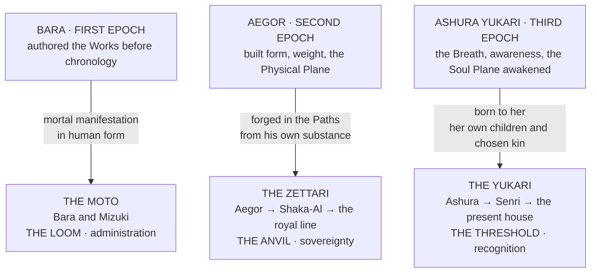

![[Assets/Paintings/houses-bloodlines.webp]]

# The Archaic Bloodlines

> **Bara wrote meaning. Aegor built form. Ashura remembered why.**
>
> The Moto carry the Scribe's mandate. The Zettari carry the Smith's endurance. The Yukari carry the Breath's own blood.
>
> **Thread, Weight, Breath. Purpose, Form, Meaning. Three Epochs. Three bloodlines. Three ways of holding reality together.**

Tessaly Wray was a junior Measurewright, nine years out of her indentures and frightened of nobody, when she hired a wool hall at Kessen ford in the wet spring of 533, hung it with Accord blue, and announced at a silver a seat that she would put the old blood under a brass assay coil in front of witnesses and settle the matter. Six hundred people came, some of them with lunch. A Byakuya lady in near-white sat down first, and the coil gave her Stage to the rung and Tier to the mark, clean as a butcher's scale, and of the thing looking out of her eyes it gave nothing whatever. A Yukari cousin in black with silver at the cuffs sat down next, and the coil did exactly the same, and while it did he told the coil's maker, from the chair, in a mild voice, which of its windings had been cut by a man in debt, and to whom. The hall came apart with joy. Wray's report ran to six lines. The Accord sealed it, fined her the seat money and took her post, and she went off to keep bees and tell the story to anyone who bought her a drink, which is how I have it.

Every roll in the world is built to pretend that afternoon never happened. Here is why it did.

---

## What a Bloodline Gives

**A bloodline gives four things and never a Path.** A Path is recognized off how a person has lived, and no quantity of ancestors has ever lived anything on your behalf.

| What it gives | What that means |
|---|---|
| **An eye** | A way of seeing that the blood carries and no school can teach |
| **A grip** | One [[The Magic System/The Soul and the Climb/Classes and the Three Ladders|ladder]] opens early. The cap never lifts |
| **A stat lean** | What comes easily, shown on the sheet under race and lineage |
| **Lens affinities** | The Wellsprings the blood takes to, which go easier and lock nobody out of the rest |

A Path figure on a lineage page is a lean of the untrained soul, what such a child tends to do with a free afternoon. It never sets Mastered or Walked.

---

## The Three Epoch Lines

Three of the old lines have an Epoch behind them, one to each road, and those three carry something more: an **instrument**, written by the Epoch and held in pieces. Each is the far end of its road, and everyone else climbs the same ladder without it.

| | **The Moto** | **The Zettari** | **The Yukari** |
|---|---|---|---|
| **Epoch and road** | Bara, Fate | Aegor, Body | Ashura, Spirit |
| **The eye** | The [[Factions, Bloodlines & Institutions/Houses and Bloodlines/The Archaic Bloodlines/The Moto Bloodline/The Moto Bloodline|Shingan]] | The Everlasting Eye, up to the [[Factions, Bloodlines & Institutions/Houses and Bloodlines/The Archaic Bloodlines/The Zettari/The Zettari|Origin Eye]] | The [[The Disciplines/Schools and Bloodline Arts/The Ketsumyōgan — The Binding Fate Eye|Ketsumyōgan]] |
| **The instrument** | [[The Disciplines/Schools and Bloodline Arts/Hataraki — The Works of the Plane of Fate/Hataraki — The Works of the Plane of Fate|Hataraki]]: seven Works, one truly held | [[The Disciplines/Named Arts/Matla|Matla]]: nine Practices, one normal | [[The Disciplines/Schools and Bloodline Arts/Null-Light|Null-Light]]: seven Regards, one normal, two rare |
| **Its law** | Fate is labor | To exist is to bear | To be known is to be held |
| **The grip** | Thread Class early | Aether Class early and clean | Thread Class early, for the eye's edits |
| **The climb** | Read, lean, prerequisite, field | Object, contact, recognition, law, system | Hears, is answered, reads wholly, holds, holds many |
| **The price** | Blood, and a corruption vector on every Work | Load, and a Failure Vector on every Practice | The Long Look, and the Threadburn in the eye |

So a Moto of Ruin may lead on the Body road, a Zettari may be a scholar and a Yukari may hit people, and each of them still has what the blood gave. A great many of them do exactly that.

---

## The Triune Equation

| Line | Inheritance | How the connection was made | The cost it carries |
|---|---|---|---|
| **The Moto** | The Shingan and Hataraki. **Lawful perception and lawful function** | **Chosen.** Bara selected them, marked them, and delegated authority within the same cosmic period | Every Work carries a corruption vector, and the house's own founder warned that **nothing becomes more monstrous, more quickly, than a righteous fool with correct metaphysics** |
| **The Zettari** | The Everlasting Eyes and Physical Plane authority. **The body as the first throne** | **Forged.** The Epoch shaped their bodies and their mandate from his own substance | Their bodies reach combat maturity faster than their emotional architecture. **Their greatest risk is not weakness. It is becoming powerful before they become wise** |
| **The Yukari** | The Ketsumyōgan, Ashura's own sight in a mortal body, and Null-Light, her instrument. **Thread-sight across all three planes, and a thing known and held** | **Born.** Ashura walked the waking world as Ashura Yukari, kept a house and bore children; the family is exactly as old as the Third Epoch | The Threadburn, because a mortal Crystal was never built to carry an Epoch's sight; and the [[Artifacts/The Immortal Cross\|Immortal Cross]], a test the family keeps and no Yukari born can pass |

---

## What the Three Have in Common

**None of them is a noble house.** All three predate every crown currently sitting, and all three hold an inheritance that a crown cannot confer and a coil cannot fully measure. This is the specific fact that makes them politically dangerous: **the Accord's whole legitimacy rests on measurement recognizing no bloodline, and these are the bloodlines the measurement cannot fully account for.**
> And all three inheritances are **perceptual before they are martial.** The Shingan determines what layer of reality the bearer can see. The Everlasting Eyes reveal where the body, soul and Aether system can be broken. The Ketsumyōgan reads the connective tissue between planes.
>
> **Three archaic bloodlines, and each of them is an eye and an instrument.** The eye tells the bearer what is there. The instrument decides what may be done about it, and an Epoch wrote it.

---

## The Quarrel That Has Never Closed

The oldest inter-house tension in mortal history is between the Moto and the Yukari, and it is **as old as Ashura's first children.**
> **The Moto see the threads as property.** The Loom is theirs. Bara delegated it. Their administrative mandate gives them jurisdiction over the Plane of Fate's architecture, **and that jurisdiction extends to the perception of it.**
>
> *No one should see the threads except those authorized to see them, and authorization flows from Bara through the Moto and nowhere else.*
>
> **The Yukari see the threads as reality.** The connective tissue of everything that exists, which their mother came into the world to set moving.
>
> *To claim ownership of the threads is, in the Yukari tradition, like claiming ownership of gravity: a statement that reveals more about the claimant's need for control than about the nature of the thing being claimed.*
>
> The Moto fear the Yukari **the way a chancery fears a witness it cannot swear in**: such a witness could never overthrow the chancery and has no wish to, and she can see what the chancery is doing, **and the seeing itself is an uncontrollable form of power.** That the witness is an Epoch's own family makes it worse.
The Zettari sit outside that quarrel entirely. Their response to the Yukari has been consistent across every era: **not friendship, not alliance: respect**, in the Zettari sense. *The acknowledgment that another being's function is lawful, useful, and complementary to one's own, and that the being who performs it deserves to be left alone to perform it.*
> When a Zettari meets a Yukari, the response is typically a nod. **Not a bow. Not a salute. A nod.**

---

## The Lines With No Epoch Behind Them

The other old houses have the same four slots and no instrument. Whatever they have done with their blood, they did themselves, and they will tell you so. The **Yuno** have the keeper's eye for an interval, and hold the sacred and the speaking in one line. The **Valorin** have no Crystal at all to speak of, a soul that grew as written pathways, which reads on the Paths and ladders the same way. The **Mahuo** are written two ways and known to this office chiefly by what they have signed.

---

- [[Factions, Bloodlines & Institutions/Houses and Bloodlines/The Archaic Bloodlines/The Moto Bloodline/The Moto Bloodline]]
- [[Factions, Bloodlines & Institutions/Houses and Bloodlines/The Archaic Bloodlines/The Yukari Bloodline]]
- [[Factions, Bloodlines & Institutions/Houses and Bloodlines/The Archaic Bloodlines/The Zettari/The Zettari]]
- [[Factions, Bloodlines & Institutions/Houses and Bloodlines/The Archaic Bloodlines/The Yuno Bloodline]]
- [[Factions, Bloodlines & Institutions/Houses and Bloodlines/The Archaic Bloodlines/The Mahuo Family]]
- [[Factions, Bloodlines & Institutions/Houses and Bloodlines/The Archaic Bloodlines/The Valorin Family]]
