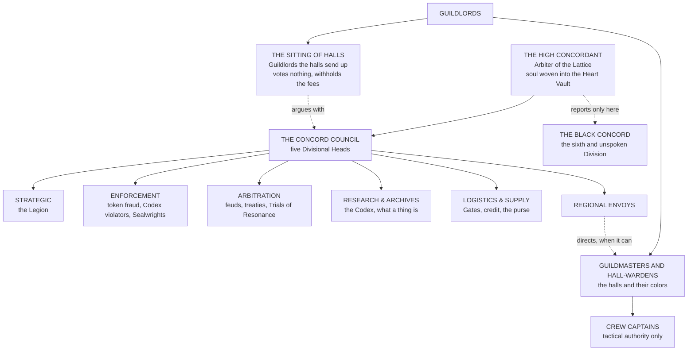

![[Assets/Paintings/guild-accord.webp]]

# The Guild Accord

*A Coalition of Guilds, with a Codex of Law, Rank, and Resonance* · filed under the Concord Codex, Supreme Treaty of All Wellspring Practitioners
> *"To temper the soul is to preserve the world."*
>
> *Carved over the Citadel's door. Painted over the door of the hall at Sedgeby, under it, in another hand: "Fees payable before the soul is tempered."*

![[Assets/Emblems/guild-accord.webp|320]]

*The emblem of the Accord: level scales for Balance before Dominion, the interwoven bands of the Concord Lattice, and at the center a fragment of Soul Crystal.*

---

On a fair day at Tollgarth in Year 709, in the middle of the Hundred Crowns, where nobody has ever agreed about anything, a crew called the Nine Bad Ideas dragged a horned river boar the size of a brewer's dray into the market on a hay sled, with their captain singing and one of their number holding his own knee on. They wore green sashes, they had been hired by a village three kingdoms away, and not one of them had ever seen Tollgarth before. By the fourth bell the leg had been set by a bonesetter in a White Apron who took a Journeyman's silver token for surety and asked for no coin. A Mercers' factor had bought the hide and the tusks at the stall, inside what his own token let him sell, while the crowd argued about the price and enjoyed it very much. The boar's core had gone on the beam in the yard and then into a Drafter's padded box against a stamped receipt. A girl in the yellow of the Long Relay was already over the bridge with a bill drawn on the crew's own hall, and her horse had not been asked to pay anyone.

Then Queen Tizz Copperwick of Tollgarth came down in her second-best crown, three foot five in her boots, with forty men and one arm of her own design, and claimed the carcass as a toll, on the ground that it had crossed her road. The market court sat in the same building as the beam. Under the dusty foot it had to hear the Bad Ideas before the market closed, and the captain, still singing, walked the whole court out to look at the road, which had a hole in it you could lose a calf in. A keeper may take a toll only where she keeps the stretch passable. The Queen was amerced to her means, which came to a modest sum, and she paid it in front of the crowd with a bow, because every debt she owned was written on instruments that court could void, and because she knows a good show when she has lost one. The crew had never met any of the people who saved them that afternoon, and never would again, and every one of those people had dealt with them on sight, on the strength of a bit of silver and a color of wax.

That is the Guild Accord. **It is a coalition of guilds across many nations: adventurers' guilds, merchant guilds, craft guilds, alchemists, healers, couriers, free companies and a good many more,** thousands of halls under hundreds of colors that loathe each other cordially, and they have signed on to one thing together. A title earned in one hall counts in all of them, a contract sealed in one court binds in the next, and a member on the road gets through. Crowns tolerate it and fear it, in about equal parts, and most of them owe it money.

---

## Who Is In It

| Kind of guild | Who they are | What you see | Names to know |
|---|---|---|---|
| **Adventurers' guilds** | Hiring halls for crews: monster hunts, dungeon clears, escorts, retrievals, whatever is on the board | A green door, a board pinned three deep, a yard full of people comparing scars. Every hall has its colors and its song | **Sedgeby Hall** on the river; **the Long Rope** at Sealhall, who work the Tail; **the Red Caps** at Verath, who touch the posts for luck and go past them; **the Company of Adventurers**, who subscribe the money and keep the tables of mortality |
| **Merchant guilds** | Dealers who make nothing and own everything: mercers, salters, vintners, factor houses | A counting-room with a very good lock, and a factor who will tell you the price of your boots | **The Mercers' hall at Waxgate**; **the great houses of Altherion**; **the factor houses of the Amber Cities**, in amber surcoats, who signed with the first circle and have regretted the fee ever since |
| **Craft guilds** | The companies of makers, each with its Master, its Clerk and its feast: smiths, engravers, assayers, waxmakers, chandlers, saddlers | Scarlet aprons, guild marks embroidered as large as a platter, and a riding at midsummer that ends in a fight | **The Twelve Great**; **the Worshipful Company of Waxmakers**; **the Engravers** |
| **Alchemists** | Those who pour Drafts and render monster cores into them, under the Bench's Standing Index | Stained fingers, a padded box, a shelf you may not touch | **The Worshipful Company of Drafters**; **the Alchemists' Society**, whose Court cannot be bought into |
| **Healers** | Bonesetters, leeches, physicians, wound-wardens and the Vitalia hands who charge for it | White aprons, a price board by the door, and a line. **Healing is priced.** The rich walk off what cripples the poor, and the guild's whole conscience lives in an argument about that sentence | **The Company of Leeches and Bonesetters**, called the White Aprons |
| **Couriers** | Riders, runners and high-Grade messengers who carry letters, bills and sealed things | Yellow coats going past at speed, a relay stable every day's ride, and a bag that nobody opens | **The Long Relay**; **the beacon wardens**, who keep the lamp line and regard the riders as a nostalgic hobby |
| **Free companies** | Mercenaries who sign under seal, take a contract, and fight as if their wages depended on the instrument holding, which they do | Loud colors, a rank list painted on the wagon, and a recruiter buying drinks | **The Scarlet Tally**; **the Nine-Fingered Company**; **the Marrick companies** of the Long Fields, who do not fight off contract for anyone; half the rest hire out of Halcrest |
| **And the rest** | Scriveners and notaries, ferrymen and carters, wardens and ward-cutters, shipwrights, heralds and minstrels (who are licensed to get things wrong), and any trade with a hall and a fee | Their own colors, their own feast, their own grudge | **The Scriveners of the Long Bench**, who will outlive you |

**Sects stand beside it.** A sect is a school with a wall, and it answers to its elders, and its elders consider the whole coalition a tax on talent. A good many of its core disciples carry a guild token anyway, because a token is what gets you paid.

---

## What Signing Buys

A hall signs for three things, and every other thing the Accord has ever done grew out of them.

**Shared rank.** The same nine titles in every guild: Initiate, Apprentice, Journeyman, Adept, Expert, Master, Grandmaster, Archmaster, Paragon. Each one grades **trust in that trade**. A merchant may deal up to his title, a craftsman make up to hers, an adventurer take commissions up to the same Threat Tier, and a stranger three kingdoms from home knows what he may safely hand you. It travels as a silver token at the belt. A forged token is a great crime in every realm that has signed. Fighting guilds keep the Stage table as their yardstick, so their title says how dangerous you are as well, and a Grandmaster merchant may not be able to throw a punch. See [[Factions, Bloodlines & Institutions/Powers and Polities/The Guild Accord/Structure and Rank/The Tiered Path|The Tiered Path]].

**Enforceable contracts.** An instrument in the formulary's wording, attested and sealed in colored wax, binds in the market court of every signed hall, and the dusty foot hears a traveler before the market closes. Nobody else in the world can promise this. A crown's writ stops at its border, and the Accord's stops nowhere that wants to go on selling things. See [[Factions, Bloodlines & Institutions/Powers and Polities/The Articles of the Accord, and the Kinds of Polity|The Articles of the Accord]].

**Passage.** A signed member travels on a road-writ at a fixed toll, is fed at any hall at the hall's price, and may leave a sealed bag with any Long Relay stable and expect to see it again. The sworn can go further, by Gate. See [[Factions, Bloodlines & Institutions/Powers and Polities/The Guild Accord/Seats and Arms/The Concord Gate Network|The Concord Gate Network]].

**What it costs.** The hall-fee, every quarter day. One weight and one measure, tested by a Measurewright (the Accord's sworn assayer, who comes through on circuit with a fork and a bad temper) who will say in public that yours lie. Every job posted to the board at its true Tier. Disputes with other signed halls taken to Arbitration before anyone burns a wagon, or at least soon after. And a standing exposure to the Accord's one real weapon, which is exclusion: a hall struck from the roll finds that its tokens no longer pass, its letters no longer clear and the rider has stopped coming.

**What crowns make of it.** They need its weights, its courts and its credit, because a merchant crossing three provinces of one crown crosses three legal systems and will not do it without somebody's wax. They also notice that their own subjects are carrying silver from a body that answers to none of them, that it holds more of their paper than they do, and that it has a sworn force in blue and white and an office whose presence is martial law. So they license it, tax it where they dare, appoint a Mage Royal to loathe its officer in every room, and do not cross it twice.

### Two doors: signed and sworn

There are two ways to belong, and half the arguments in any hall come from mixing them up.

**Signed** is wax. A hall signs its charter into the coalition, and its people carry its titles. A merchant who has never woken a Crystal is signed, and so are most bakers' Wardens and every free company on the road. Leave and you lose the token, the courts and the road. You keep your soul.

**Sworn** is the older thing, and it is why the Accord has a Codex at all. Agents of the Citadel, Enforcement's orders, the Legion, the Sealwrights (specialists in binding glyphs) and any practitioner who wants what only the Lattice gives, a Gate crossing above all, offer a fragment of their Soul Crystal to the **Concord Lattice**, the living web of Essence signatures that holds every sworn oath. The Soul Crystal is the soul, literally, so this is exactly as serious as it sounds. The oath is a vow with Fate on it, and it shows on the sworn person's own window in their own tongue, as vows do (a window being the soul reporting its numbers to its owner, unseen by anyone else):

```
[Oath: the Concord Lattice · sworn]
[Terms: Balance before Dominion. The Nine Laws of Severance apply.]
[Breach: lands at once]
```

> The old Codex says it without qualification, and it was once the whole of the matter. **Membership is not merely political. It is spiritual.** The Crystal remembers what the mind forgets. The Lattice preserves what time would erode. A sworn practitioner cannot resign.
>
> The Measurewrights have spent seven centuries arguing about what the Lattice is. Research and Archives holds that it is a Wellspring lens the size of a continent. The Grand Engraver's people hold that it is a very old contract. A Lector of Sancta Lux once told the Sitting of Halls it was a debt, and was not asked back.

---

## Where the Accord Stands

The Guild Accord is being made now, and it is being made in circles.

Within living memory the guilds outran every charter written for them. Hunting monsters became a trade: crews hired by the posting, ventures subscribed in shares, bounties pinned to a board in any town with a hall. A seat that could post a board could raise a hall, and halls went up faster than crowns could license them or the Codex could reach them. Merchants and makers saw what the hunters' token could do on a strange road and wanted one.

**The Codex is old.** Its sealing is Year Zero In Concordance, and the Citadel, the Divisions, the chancery's formulary and the Bench have run on it for seven centuries, in the Concord heartland (the [[Geography & the Four Quarters/The Bearing and the Holding/The Inner World — The Northern Shield/The Sealed Charter of the Concord|Sealed Charter of the Concord]], the country the Accord swears it does not have) and along the chartered routes, binding the practitioners who swore to it and the merchants who chose its courts. **The coalition is new.** The Accord proper is the guilds, and the crowns they stand in, signing on together.

A hall may sign by itself, and thousands have. Its people then carry the titles and may use the courts, and the law around them stays whatever it was. A **circle** goes further. It is drawn and signed in a hall, its names read out one by one, and it binds the halls and the crowns of a whole country under one seal and one body of law. **The first was signed in the lower hall at Kharven-Seat**, by Kharven, the Holy Sea of Alabaster, the free cities of Nalūn, and the stretches from the Brine crossing east to the marches of Sum-gol. Others are being argued over in halls and chanceries across the four quarters.

**Where a circle has signed, the Articles and the Commission framework bind as law**: every hall inside it posts to one board, grades by the same Tiers and licenses hire by the same examination. **Where no circle has signed, they do not bind yet.** There the chancery's courts sit for the parties who choose them, and the Articles are a custom a merchant may take or leave.

And the ground is crowded with those who have not signed. **Holdout guilds** keep their own boards and their own grades, and some are older and richer than any circle. **Rival hunting companies**, chartered by a crown or by nobody, bid against the halls for the same bounties, and the Well-Hunters' Company has made a fortune doing it with one licensed captain and a dozen men who have no license at all. **Unlicensed crews** work cheapest of all, take the postings no licensed party will touch, and are hired by every district that cannot pay a hall's fee.

**Reach.** Strongest on the New World's arc, chartered from nothing so that its chartered halls are the only jurisdiction there, running the Accord's text by charter ahead of any circle, though the elven old-ground beside the arc carries four Eons of Eressean law the Accord did not displace; strongest in the island nations, which cannot survive exclusion for a season; strong across the Inner World; weak throughout the Old World. The practical seam is the relay, because the Accord's reach ends where its riders and its beacon line end, so **every district the Withering thins is a district the Accord quietly stops governing.**

---

## What You Will Actually See

*An archivist's note, pinned into the open shelf's copy, because a Codex tells you what a thing claims and leaves you to find out what it looks like.*

You will see a stone hall with a green-painted door and its own colors over it, a bounty board pinned three deep, a beam (the public scales) in the yard that any person may test at any hour, and a clerk with ink on his cuff. Nobody can hand you the Accord. It lives in that hall as a seal press in a locked chest, colored wax, and a formulary that reaches you as a stamp on your measure, a token in your purse and a fine set to your means. The market court sits next door. Across the yard somebody from another guild is explaining why this one is going to hell.

Expect the people in that hall to disagree. The Hall-Warden wants fees, the trace examiner wants evidence, the crew at the long table want to know who got the kill, and the Measurewright wants everybody else to admit that the needle was right the first time. A baker meets them when her loaf is weighed, a ferryman when he tries to take a toll on a stretch he has stopped keeping, and a child when her Crystal wakes and the Hall-Warden turns up at her mother's door with an indenture and a very good dinner. Across the street there is generally a sect, in its colors, whose elders consider the whole establishment a tax on talent and whose core disciples are carrying Guild tokens anyway.

---

## The Board

> *"Duty is the crucible. The soul is the metal. The Lattice remembers what emerges."*
>
> *The Codex on Commissions. The hall's version is chalked beside the board: "Read the Tier. Then read it again."*

Every hall of adventurers lives by its **board**, and it is the loudest wall in any town: bounties, escorts, clears and retrievals, each on vellum under a colored seal, with crews shouldering past each other to get a hand on the good ones. Other guilds post to it too. A healer wants a bezoar from the third floor of something, a mercer wants a caravan walked through the Midmarch, a village wants whatever is eating the geese.

A job on the board is a **Commission**, and it carries two labels: its **Threat Tier** (T1 to T9) and its **Class**. The Threat Tier lines up with the titles, one for one. **An adventurer may take commissions up to the Threat Tier of their title:** T4 goes to Adepts and above, T7 to Grandmasters under a Gold seal, and nobody engages lawfully past their silver. The same T1 to T9 grades the monsters themselves, which gain Levels by killing, evolve at their own thresholds and stand on the same Level and Grade scale as anyone. A famous one earns a name, an epithet and a bounty, and a board that says only *The Widow of Lastpenny Ford, T6, nine hundred gold marks, dead, and bring the mask* needs no further description.

| Seal | Tier | Meaning |
|---|---|---|
| **Green Sigil** | T1–T3 | Open field work. Any hall may post it, any crew in the color may take it |
| **Blue Sigil** | T4–T5 | Multi-crew work, with a named lead crew |
| **Gold Sigil** | T6–T7 | Council-sanctioned: danger to a realm or a Domain, and a fee to match |
| **Obsidian Seal** | T8–T9 | **Black Concord orders. Classified.** Nobody in Waxgate will tell you who makes the wax |

### The five classes

| Class | Purpose |
|---|---|
| **Reconnaissance** | Mapping, scouting, Essence anomaly study, threat assessment, the first crew into a new dungeon floor |
| **Containment** | Wellspring stabilization, sealing, purification, corruption quarantine |
| **Retrieval** | Artifact recovery, relic salvage, spirit reclamation, asset extraction |
| **Arbitration** | Political or spiritual mediation between factions, nations, or divine entities |
| **Extermination** | Combat elimination of hostile entities, corrupted practitioners, or destabilized Domains |

### How a Commission moves

**Submission** · Anyone with the fee files at the nearest hall, and the fee is why villages club together. **Validation** · An Arbitration examiner, or in a small town the clerk, looks at the request for legality, risk and whether the village is lying about what ate the geese. **Classification** · Threat Tier and Class assigned, sealed in the right color, entered on the roll. **Acceptance** · The crew's captain signs in ink and sets a thumb to the wax; a sworn captain's signature also binds their resonance to the record. **Completion** · A field report, a countersigning witness, and the parts on the hall's own beam. **Reward** · The bounty, the shares, the salvage, and an entry on the roll.

**Who owns the carcass** is the commonest question in the trade. Parts belong to the crew unless the instrument says otherwise, and a good instrument says otherwise at length. Scale, bone and hide make top gear. **A monster's core is in a way its Soul Crystal**, worth more the stronger the monster: this is the lawful Crystal Draw of the Bench's [[Materials, Alchemy & Trade/Alchemy/The Standing Index|Standing Index]], and it goes to an alchemist, who renders it into Essence Drafts used for tempering. Plenty of poor hunters have looked at a core in their hand, looked at a Draft's price and swallowed it raw instead. It gives everything at once, and most die or come out wrong, and the ones who come out right are the reason the great houses are afraid of crews. **A Crystal cut from a dead practitioner makes the strongest Draft of all**, and it is the worst crime in every realm and the most profitable. No hall will admit to having seen one.

### On the ground

Captains hold full tactical authority and answer to their Guildmaster for it. A sworn captain is **metaphysically accountable** as well: every decision under a Commission's banner enters the Lattice, and deviations from sanctioned parameters **trigger automatic review.** **Cross-guild teams must declare a lead crew**, because resonance overlap between sworn signatures causes real interference when nobody knows who is in charge, and because otherwise everyone gives orders. If a Commission collapses or breaks the Codex, Enforcement takes an interest and survivors go before Arbitration. **Essence Resonance Checks are mandatory after any Commission near a Wellspring site**, since long exposure without cleansing destabilizes the Soul Crystal and skipping one is punishable under the Law of Stability, and every hall keeps a stool, a basin and a bored examiner for the purpose.

---

## Crews, Colors and Feuds

**Crews.** A crew is whoever went down together and came back, with a name, a sash or a painted shield, and an opinion about every other crew in the yard. It is rated in seal colors like the board, and its color follows the lowest title among its named members, with one allowance: a captain may carry one member a title below the rating on the bond, at a smaller share, and everyone calls that person the luggage until they save someone's life. Level moves by danger overcome, so killing something stronger moves it more than a hundred weak kills, and crews argue over who got the kill with more heat than they ever argue over money. A bond that has been earned shows as a line on each member's window and shares a little of the gain, and betrayal breaks it where they can all see.

**The Wall.** Every adventurers' hall chalks its crews on the wall inside the door in order of what they have cleared, and the order is a public scandal renewed weekly. The Accord keeps its own **Roll** of the great names. Heralds cry a different one, bookies in green hats keep the odds on a third, and every realm and sect has its own list. They all disagree, and getting on any of them makes you a target.

**Colors.** A hall's colors are its whole public self. Sedgeby wears river green, the Long Rope yellow with a knotted belt, the Red Caps exactly what you would expect, the White Aprons white until about noon. Every hall has a song, most of them rude about the hall across the river, and a fair-day riding, a feast, a place in the procession and a Beadle (the officer who carries the mace at the feast and throws you out of the hall) to defend it. You can pick out a Long Rope hand from a Red Cap at fifty paces by how they stand in a doorway, and children do it for sport.

**Feuds.** Nobody who signed gave up a single grudge, and the coalition's oldest achievement is making them expensive. The Chandlers and the Saddlers have both ridden eighth for four centuries. Adventurers' halls hate the Well-Hunters' Company for its prices and hire its men when short. Merchants outrank makers in wealth and are outranked in precedence, and neither has stopped minding. White Aprons and Drafters have been at war for two hundred years over who may be paid for a wound Draft. Cutters, pourers and singers (the old trades of runes, Drafts and chants) each hold that the other two are hobbies, a quarrel that once had ranks and examinations attached and now mostly has taverns. A feud between signed halls goes to Arbitration if anyone wants it to; most go to the Stage brackets at the next fair instead, where killing is forbidden and still happens, and the bookies can get a price on it.

---

## Who Answers to Whom

> *"The law does not govern from above. It resonates from within."*
>
> *So says the Codex. The law also bills quarterly.*

A hall runs itself, under its own Guildmaster and Court, and most members never meet anyone above that. Above it stands what a coalition actually needs, which is somebody to keep the shared things working: the Codex, the courts, the Gates, the credit and the sworn force. That machinery is older than the coalition and has its own idea of who is in charge.



> **The High Concordant.** Supreme Head, and the living voice of the Codex. Their soul is woven directly into the **Heart Vault**, the Wellspring Core at the center of the Concord Citadel, and their breath sustains the Lattice's glow across every realm. **Should the High Concordant perish without succession, the Vault stills, and the Guild Accord collapses.** Most members of the coalition think of the office the way they think of the sun, and with about as much expectation of a reply.

| Division | What the coalition needs it for |
|---|---|
| **Strategic** | The Legion, and the Gates as a military asset. **Small on purpose: the guilds hire free companies and do not want a large sworn army standing behind the clerks** |
| **Enforcement** | Forged tokens, Codex violators, Wellspring policing, Sealwright deployment. **Its High Warden's presence in a realm constitutes martial law** |
| **Arbitration** | Feuds between halls, treaties, mediation between nations, Trials of Resonance |
| **Research & Archives** | The Codex, the Archives Eternal, artifact containment, and the power to say what a thing is |
| **Logistics & Supply** | Gate coordination, Essence transport, the letters of credit, the purse |
| **The Black Concord** | *The sixth and unspoken Division. Reports only to the High Concordant. Its existence is not acknowledged in the public Codex* |

**Regional Envoys** are the Citadel's officers in a realm, and they direct Accord business there as far as the halls allow. **Guildlords** are the other direction: the voice a territory's halls choose and send up, one to the **Sitting of Halls**, which meets at Sealhall after the Veyra's Day fair, has no vote on anything the Council is obliged to hear, and has discovered that it can stop paying. **Guildmasters** command individual guilds and academies, absolutely within their own walls and subject to Envoy directives wherever the Envoy can make that stick. **Crew captains** are field commanders. *A captain's authority extends to tactical execution, and the question of whether to be there at all belongs to whoever signed the instrument.*

---

## The Culture of Duty

Every sworn Concord agent, from the lowest courier to the Chosen of the Codex, abides by a single maxim carved into every hall gate the Codex reaches.
>
> > **Balance before Dominion.**
>
> To wield Essence is to bear law. To complete a Commission is to feed the Lattice. **The Accord does not celebrate conquest; it celebrates restraint**: the measured application of power toward the preservation of equilibrium.
>
> Sworn practitioners are taught from their first day as Initiates that the Tiered Path is **a deepening of responsibility, and no ladder of ambition.** Each rank gained is another weight upon the scale. Each Wellspring defended is another thread woven into the fabric that holds reality together.

The signed halls have heard this speech. They paint the maxim over the door and spend the evening under it comparing bounties, shouting their art's name at the rafters and betting on the brackets, and nothing in the Codex has ever managed to make a hunter modest. The two cultures live in one building and the clerk serves both.

---

## The Codex in Full

The ranks and what they cost. The currency of remembrance and the nine ways a soul is unmade. The Division that is not named. The network that carries everything. The small sworn army bound by resonance, and the loud hired ones beside it. And the city that is not a city.
>
> **The Dark Ages page** is the newest and the one to open first if you are writing a scene rather than checking a rank: the wax and ink, the companies, the Divisions as rivals, the politics of the High Concordant, the academies and the great offices.
>
> **A register note.** The old codices speak of Lattice-stones, sigils hung in the air, Aether credits and echo marks, and the Dark Ages render them as **the board, seal colors struck in wax, draughts and letters of credit, and entries in ink.** Nothing metaphysical is lost. Nobody has ever seen a guild's number floating in the air. The only figures that float are on your own window, and nobody else can see those.
>
> **The Concordant cannot leave the Citadel.** Everything reaches them through five Divisional Heads who each decide what is worth carrying up, so the office is curated more than it is exercised. And because an unsucceeded death stills the Vault, the Council will accept almost any nominee rather than risk a gap, which means the contest happens entirely before the death.
>
> **An adventurer is somebody who ventures capital**, so a Commission is a venture with subscribers and shares, and the crew holds shares where it might have wanted wages.

- [[Factions, Bloodlines & Institutions/Powers and Polities/The Guild Accord/Structure and Rank/The Guild Accord in the Dark Ages — Divisions, Companies, Academies and Offices]]
- [[Factions, Bloodlines & Institutions/Powers and Polities/The Guild Accord/Structure and Rank/The Tiered Path]]
- [[Factions, Bloodlines & Institutions/Powers and Polities/The Guild Accord/Structure and Rank/Merit and Severance]]
- [[Factions, Bloodlines & Institutions/Powers and Polities/The Guild Accord/Structure and Rank/The Black Concord]]
- [[Factions, Bloodlines & Institutions/Powers and Polities/The Guild Accord/Seats and Arms/The Concord Gate Network]]
- [[Factions, Bloodlines & Institutions/Powers and Polities/The Guild Accord/Seats and Arms/The Concord Military]]
- [[Factions, Bloodlines & Institutions/Powers and Polities/The Guild Accord/Seats and Arms/The Concord Citadel]]
- [[Factions, Bloodlines & Institutions/Powers and Polities/The Guild Accord/Structure and Rank/The Practitioner Problem]]
- [[Geography & the Four Quarters/The Bearing and the Holding/The Inner World — The Northern Shield/The Sealed Charter of the Concord]]
