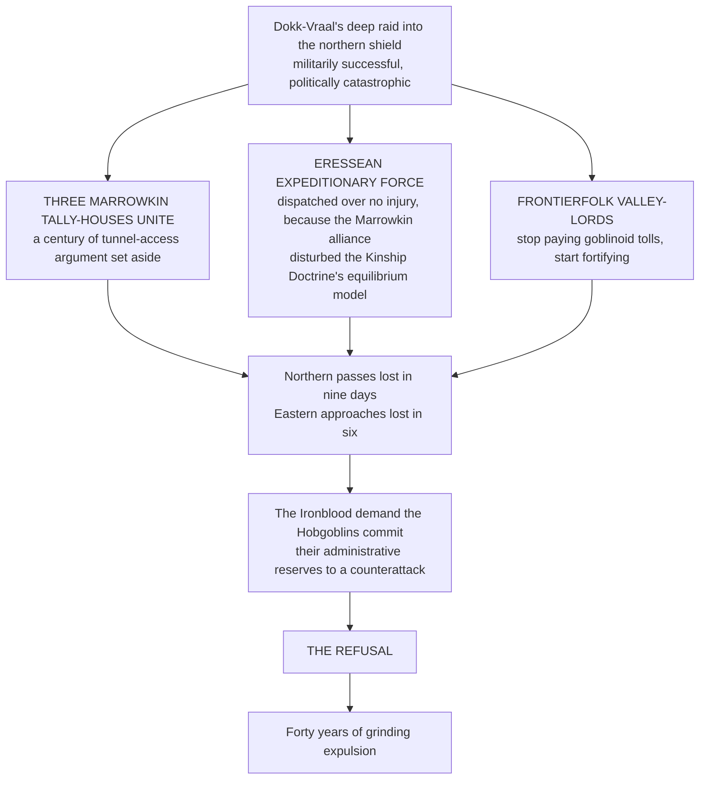

![[Assets/Paintings/realm-crimson-isles-of-vorruk-khal.webp]]

# The Crimson Isles of Vorruk-Khal

**Say it** · *Vorruk-Khal* VORR-ook KHAHL · in most mouths, the Hobgoblin Expanse, HOB-gob-lin ek-SPANS

**Vorruk-Khal · The Held Ground**

> *Vorruk* is ground that tried to move and was stopped, which no farmer means by ground. *Khal* is held as a wound holds together after stitching, and a hand holds a cup some other way.

The Keth-Gorrum was halfway through the annual roll on kelp-bed boundaries, in the spring of 612 IC, when Gorr-Keth, nine leagues up the crescent, blew the side out of its cone. The moot sits under open sky and has refused an awning for as long as it has been asked, so the whole assembly had an excellent view. The sky over Khal-Serrat went the orange of a smith's apron and then a deep bruised violet, the red banners along the cliff-top stood straight out in the hot wind, and stones the size of loaves began coming down on the moot floor, trailing smoke. A Tinker Voice moved to adjourn. The Speaker, a Hobgoblin named Sahl-Venn in Crimson Order scarlet, ruled that a motion to adjourn requires a roll call, that a roll call once begun must be completed, and that the kelp roll had been begun first.

So one hundred and twelve Voices stood under a rain of hot rock and answered to their names. Coats of aura went up along the benches, sulfur-yellow and basalt-blue. The Bugbear Voices planted themselves where they sat and the stones broke on them. A Fleshshaper advisor, who does not vote, walked the aisle setting bones and telling people what she thought of them in language the record calls direct. The kelp roll finished, the motion to adjourn failed by six because the ash had by then stopped falling, and four Voices who had died in their seats were marked present, since they had answered. The reef families, who had watched the mountain burn pink and gold over the water from their boats, were told about the session a week later and asked whether the kelp line had moved. It had not. It is in the Rock.

Forty-three volcanic islands make up the Crimson Isles, black rock and red banners, with a war-moot held under the open sky at the foot of a cliff and no king anyone has ever been able to find, and they would like you to wait your turn to speak.

---

## Overview

A volcanic archipelago of **forty-three islands** strung across the water south of the one great land, past the sea below the Holy Sea of Alabaster and the Copper Coast, where the old charts run on toward the Outer World's western shelf. The Concord charts name it Vorruk-Khal, which is Old Vaross, though the phrase carries a weight the translation does not. Its people are the Hobgoblins of the Crimson Order and the Bugbears who came with them, with Tinker Goblin workshops and Fleshshaper quarters besides, and every town flies the same red banner with nothing on it, since a device would imply somebody whose device it was.

The islands are young. They belong to the same volcanic arc that built the New World's eastern seaboard, a chain of andesite peaks pushed up by the same subducting plate at a different angle. The tallest, **Gorr-Keth**, reaches four thousand feet above the waterline and glows orange at night when the wind shifts. The smallest are little more than basalt shelves a few hundred paces across, colonized by lichen and by Tinker Goblin signal-fire and mirror posts that have been there long enough that nobody remembers who built the first one. Black beaches, yellow sulfur crusts around the vents, green terraces up every caldera wall, a sea that goes from ink to jade over the shelves: it is the only black country in the world that anyone has ever called gaudy.

Fourteen of the forty-three are inhabited year-round. The rest serve as seasonal fisheries, volcanic-glass quarries, sulfur fields, or navigational markers. **Three are forbidden entirely**, with nobody enforcing the prohibition, because the ground shakes there in frequencies that make Stone-Blood vibrate at the wrong harmonic, and the Bugbear population discovered this the hard way four centuries ago and has not needed to rediscover it.

> The Crimson Isles are the largest self-governing goblinoid realm in the four quarters. **They have no king, no warlord and no hereditary seat of any kind.**
>
> What they have is a war-moot, and the war-moot is older than most of the kingdoms that regard it as a curiosity.

They are also, with the [[Geography & the Four Quarters/The Bearing and the Holding/The Inner World — The Northern Shield/The Iron Mandate of Undaar-Keth — The Closed Fist|Iron Mandate of Undaar-Keth]] that they disapprove of, the standing enemy of the North, for reasons that begin with a toll: see The Unpaid Toll, below.

---

## The Scattering · Grr-Vashuum

In the long age before the Scattering, the goblinoid peoples held territory in the western quarter's mountain passes, where the rock was closest to the asteroid's original composition and the Stone-Blood ran strongest.

They were ruled, loosely, by **Ironblood Orc warchief coalitions.** The word *ruled* does too much work. What the Ironblood provided was a chain of command running on kinetic hierarchy: the strongest warband held the best passes, the passes controlled the trade, and the trade funded the war-parties that held the passes. It was circular. It functioned, the way a wheel functions on a slope, which is to say it kept moving and the movement was its own justification.

The **Crimson Order** existed within this structure, but uncomfortably. Hobgoblin discipline and Ironblood volatility occupied the same valleys the way two predators share a forest when neither can afford to leave. The Hobgoblins administered the granaries, kept the glyph-wards, and trained the mixed formations that held the passes against Marrowkin incursion from the north and Elven pressure from the east. They were, by every measure except the one the Ironblood cared about, **the architecture of the goblinoid presence in the Old World.**

*The measure the Ironblood cared about was violence, and they were better at it, and they said so with the regularity of a church bell.*

### The three stages of collapse

> The refusal is the moment the Ironblood call **the Betrayal of the Mountain**, and that the Crimson Order calls **the First Rational Act.**

What followed was a grinding expulsion over approximately forty years. Ironblood warbands broke into raiding parties and scattered to every quarter that would tolerate them. Verdant Orc bands slipped into the deep wetlands of the southern interior and were not seen again for centuries, and their heirs now hold the Moss Court in the Moonlight Forest of Mosk-Vaal. Some of the Crimson Order would not leave at all, and dug in on the western shield, and became the Mandate. The rest of the Order, with whatever Tinker Goblins and Fleshshaper enclaves would follow, withdrew southwest along the coast **until they ran out of coast** and found the volcanic chain rising out of the water.

The Hobgoblin name for this is ***Grr-Vashuum***, built from *grr-* (a force event, kinetic, percussive) and *vashuum* (a thing that opens where it should not). **It is the word for a fault line that splits a load-bearing wall.**

> The Ironblood use it too, but they pronounce the second syllable shorter, as if the breaking was quick and clean. The Hobgoblins hold the vowel. **The breaking was not quick.**

---

## The Seventh Lineage · The Bugbear Peoples

**Mantle-Born · Gorr-Veshaal**

| **Type** | Major Race, Asteroidal Depth-Kin / Endurance-Forged |
|---|---|
| **Origin** | Second Epoch. Born from the **mantle layer** of the First Impact, the intermediate mass between the core that compressed and the shell that shattered |
| **Metaphysical Anchor** | Essence (Gravitational / Passive), inertial mass, with neither the kinetic force of the shell nor the structured lattice of the core |
| **Spiritual Lineage** | **The Weight-That-Stayed.** Where the core compressed and the shell exploded, the mantle did neither. It absorbed |

They are the largest of the goblinoid peoples, standing between seven feet and eight feet four, and they carry their height differently. **An Ironblood Orc's body is built for output. A Bugbear's body is built for absorption.** The shoulders are wider than a Hobgoblin's and sloped rather than squared, distributing load across a frame that was never designed to throw a punch first. The chest is deep, not broad. The waist does not taper. The legs are short relative to the torso, thick, rooted, set wide in a stance that looks casual until someone tries to move it.

Their skin runs darker than any other goblinoid lineage: deep charcoal gray to near-black, matte, absorbing light in a way that is difficult for other races to look at directly. Their Stone-Blood runs thickest but slowest, and the asteroidal mineral deposits in their tissue are arranged in **layered striations** rather than the Ironblood's jagged scars or the Hobgoblin's geometric etchings. Under the skin the layers are visible as faint banded patterns, gray on darker gray, that shift when they move. *A Bugbear in motion looks as if the mountain itself is rearranging its strata.*

> Their hair is **sensory**. Bugbear hair follicles contain a density of Aetheric nerve endings that allow them to read ambient Essence pressure changes through the scalp. They feel weather, Wellspring fluctuation, and hostile intent **before any other sense registers it.**

### Axiomatic traits

| Trait | Function |
|---|---|
| **Gravitational Anchor** | Passive weight multiplication. A Bugbear who plants and chooses not to move becomes functionally immovable by any force below Grade A kinetic output. Stone-Blood increases effective mass by a factor of **six to eight**, involuntarily, under threat. Knockback, displacement, and forced-movement glyphs lose **60% to 80%** of their effectiveness against a set Bugbear |
| **Inertial Dampening** | The mantle's inheritance. Impact force is reduced by **transmission rather than deflection**, dispersed across the entire layered tissue structure. Where an Ironblood converts received force into stored kinetic energy, a Bugbear simply takes less damage, permanently, passively, without activation cost. **25% baseline, scaling to 40%** under sustained bombardment as the tissue compresses and hardens |
| **Presence Gravity** | At Stage VI and above, a passive Aetheric gravity field within roughly fifteen paces. **The pull is metaphysical, with no physical force in it.** Ambient Essence flows toward the Bugbear rather than dispersing, and practitioners inside find their own expenditure increased by roughly **+8% AU cost** on all active techniques. The Bugbear does not benefit from the gathered Essence. It simply pools and dissipates slowly. *A high-Stage Bugbear warps the tactical economy of an engagement merely by standing in it* |

> **Key limitation · Inertial Lock.** A Bugbear who has activated Gravitational Anchor cannot transition to full combat speed for **2.4 seconds** after release, during which their reaction time drops to human-baseline. **This is the window.** Every opponent who has fought a Bugbear and survived learned to read the release.
>
> **Speed Deficit.** Travel speed caps at roughly 60% of an equivalent-Grade Ironblood Orc. They are slower than the thing they are most often compared to, *which has been enough to get them killed in open-field engagements where mobility determined survival.*

### Cultural lattice

**Language** · Low Goblintongue for working. **Gorr-Vaross** among themselves, a Bugbear dialect of Old Vaross distinguished by extended vowels held at sub-bass registers that physically vibrate the listener's ribcage at conversational distance. *Formal Bugbear speech is felt before it is understood.*

- **The Laying of Weight: responsibilities as part of the body**
  When a Bugbear assumes a new responsibility, a seat in the Keth-Gorrum, a wardship, a marriage, a sworn contract, they carry a stone from the shore to the peak of the nearest island summit without stopping. The stone must be heavy enough that the climb takes effort.

  **The act is structural.** Bugbear Stone-Blood responds to sustained gravitational load by deepening its layered compressions, and a Bugbear who has carried many stones has a measurably denser Aetheric signature than one who has not.

  Their responsibilities are, in a literal metaphysical sense, part of their body.
- **The Long Silence: grief felt in the follicles**
  When a Bugbear of consequence dies, every Bugbear within earshot of the announcement stops speaking for one full day. Nobody vows it and no rite requires it. **It happens to them.**

  The sub-bass frequencies of Gorr-Vaross carry a harmonic signature unique to each speaker, and when a known signature ceases, the absence is physically perceived by every Bugbear whose hair has ever registered it.

  The silence is grief felt in the follicles, and **it takes a day for the sensory absence to stop triggering a searching reflex.**

**Signature imagery** · Layered basalt columns, deep shadow, carried stones, and the Closed Fist resting on a flat surface, the gesture that means *I am staying.*

**Relations** · Permanently allied with the Crimson Order by the moot's integration. **Respectful contempt for the Ironblood Orcs**, whom they regard as an argument for rule that has been losing since before the Scattering and has not yet noticed. Cautious trade with the Marrowkin, who share their experience of building a home on ground nobody else would have. They describe Elves as *"people who have never carried a stone in their lives and it shows."*

---

## Geography of the Isles

The forty-three islands are arranged in a rough crescent running southwest to northeast, following the volcanic arc's surface expression. The crescent opens north toward the white shelf and the Thousand Moorings, approximately two hundred leagues off. The southern horn trails toward the Outer World's western shelf, where the water shallows over ancient craton, the fishing is good, and **the Crevice's influence is not yet measurable.**

| Tier | Count and elevation | Function |
|---|---|---|
| **The High Islands** | Seven, peaks above 2,000 ft | The oldest Hobgoblin settlements, built into caldera walls and leeward slopes where the volcanic soil is deep enough to farm. Terraced agriculture produces taro, breadfruit, volcanic-ash grain (a Tinker Goblin cultivar of three centuries ago that they have been failing to improve ever since), and **thurr-kep**, a root that grows nowhere else and tastes, according to every non-goblinoid who has tried it, *exactly like charcoal mixed with honey* |
| **The Shelf Islands** | Twenty-two, 300 to 2,000 ft | The working backbone. Forges, shipyards, obsidian quarries, sulfur works, and the moot-isle of Khal-Serrat. Densest population: mixed Hobgoblin-Bugbear communities with Tinker Goblin workshop enclaves and a persistent Fleshshaper quarter on **Krev-Mol**, where the ambient Essence is irregular enough that their self-modification practices find raw material more easily |
| **The Low Reefs** | Fourteen barely above the waterline, plus uncounted tidal shelves | Fisheries, kelp farms, signal relays, and the vent-forges the Marrowkin taught the Hobgoblins to build, which run on the heat the sea floor gives up. Permanent residents are predominantly Bugbear fishing families who regard the moot with **the tolerant disinterest of people who have never needed its help and expect never to** |

### The towns

**Khal-Serrat, the moot-isle.** The old tallies give the island as Vesh-Undaal, a Bugbear form, and every chart since the Gold Flood gives it by the town. *Serrat* is an old word for the place where a weapon is set down, so the name is a setting-down of the stitched kind. It is a huge terraced fortress-city of rust-red and black volcanic rock, stacked up from a black-stone harbor, with every wall ending in curved spikes, tall red banners hung down its faces and firelit gold in its deep doorways, on ash-pale ground under an amber sky. Strangers come up the ash road on foot, two or three to a party in their cloaks, and look smaller at every step. At its heart, at the foot of the great cliff and under open sky, lies the moot floor. On moot days every room is let twice, the rope-walk closes and the families of the Shelf delegations sit on the sea wall and bet on how long the morning's roll will run.

**Krev-Mol.** The fish market opens before dawn under strings of blue-glass floats, and the Fleshshaper quarter sits behind it, with its coats left open to show the work. **Mokk-Vesh,** on the next island along, is the great shipyard, where the volcanic-glass-hulled ships of a design found nowhere else are laid down with Tinkers swarming over the frames and the shipwrights shouting at them to stop helping.

**Gorr-Keth.** The caldera towns on the mountain are the oldest in the Isles, terraced and green, with a founder's pride and the best view of the thing that might kill them. Under them are the deep slag-yards, and the page owes you an honest word on those.

### Under Gorr-Keth

The great forges of the High Islands run on goblin bellows-gangs, in turns that never end, down in yards the moot's delegations do not tour. Children go onto a bellows-handle at six. A yard goblin of twelve can tell from the note of a roof-timber how long it has left, a skill everyone on a gang has and nobody talks about, since when a forge-roof comes down the entry on the board is one line. The Tinkers hold four guild-seats at the moot and are loud about the vote they do not have. The yard goblins hold none, because the residency count runs by hearth and a bunk is no hearth, and every goblin in the deep yards knows the iron-red banner of the Mandate from its contract-foremen long before they could tell you who speaks for them at Khal-Serrat. The Isles that opened their palm have this under them. It has been raised at the moot eleven times and is cut into the Rock under the heading *Deferred*.

### Rent, food and the street

The Shelf towns are as loud as the Rock is formal. Obsidian cutters and sulfur men wear their guild colors to the Breakwater brackets on Krev-Mol, where Bugbear anchor-schools bet on who can be moved and nobody ever wins much, and the petty trades run on every dock: a net-mender whose knots do not slip, a Tinker who sharpens anything at all and sometimes on purpose, a Fleshshaper who will take out your bad tooth and asks whether you would like a better one. Rooms on the Shelf are rented by the season and paid by weight, in sulfur or glass, since the Isles price in barter by old habit. Supper is taro, breadfruit and Shelf fish, and strangers are offered thurr-kep so that everyone can watch them try it.

### Wealth

Sulfur and obsidian, first and always: brimstone for the bleachers, vintners, physicians and siege-fire of half the world, and volcanic glass for edges, lenses and the hulls no one else can build. Then fish and kelp, Tinker work with a shouted guild mark, and glyph-inscription under seawater pressure, which only they do. All of it is priced in weight-barter rather than coin, and has been since before anyone can remember a reason. The Isles buy grain and timber, because ash grain is what it is and a volcano grows few masts.

---

## The Keth-Gorrum · The War-Moot

The moot meets on **Khal-Serrat**, under open sky, below a shelf-tier island's entire western face: a sheer basalt cliff carved with the records of more than seventeen centuries, and the last seven hundred and sixty-five of them unbroken. It is called the Rock.

> The records are **load-bearing.** Every motion passed, every treaty ratified, every war declared and every war refused is inscribed into the cliff-face in High Concord script, and the inscriptions are Engraved in the Crimson Order sense: they carry Aetheric weight.
>
> **A law written into the Rock cannot be mislaid the way a hide is mislaid. It is a fact about the stone, and the stone remembers.**

The day-to-day registers are kept in Old Vaross tally-cuts, a room full of timber boards behind the harbor. Every entry in it can be destroyed with an axe. This has happened, and the Isles' law has a hole in it where the year 411 used to be. The crest of Sir Hamon Manningtree of the Concord is nailed to one of those boards, a peacock in scarlet, from the Salt Ford parley, where he took a hobgoblin kaan's slowing voice for surrender and told his trumpeters to sound the victory.

The name combines the Open Palm gesture (*Keth-ur*) universal to goblinoid culture with the Old Vaross root *gorr-*, meaning assembly, or mass, or the-weight-of-many-standing-together. **The name is a statement of method:** rule by open argument among those who carry weight, with hereditary right and combat supremacy both ruled out of order, and the accumulated mass of argument, evidence and responsibility in their place.

**Why a war-moot.** The first of them was called on the edge of a fight, and the form has never forgotten it. Every Voice comes armed, in harness, as to a muster, and stacks spear and blade in the racks at the foot of the Rock before taking a seat, palms open, which in every goblinoid tradition means *I have already laid down the more important weapon.* Foreign envoys read the gesture as peace, and have been badly surprised. The moot's first business in any year is the roll of wars standing and wars refused, and it can decide in a morning to send the fleet.

**The look of it.** Black rock under a blue morning, Order scarlet down the Hobgoblin benches, the Bugbears a long dark mass that seems to take the light off everyone near it, red banners cracking overhead, guild colors and gulls. Rain is a motion, which has failed, and so is the awning.

### Composition

**One hundred and twelve Voices**, apportioned by island and adjusted every twelve years by a count of hearths, walked house to house by two Voices who dislike each other. The present apportionment gives the seven high islands thirty-eight seats, the shelf islands fifty-six, and the low reefs eighteen. A Voice stands for six years.

**There is no king and no lord. No separate court sits apart from the moot.** What there is, is a **Speaker of the Rock**, chosen from among the seated Voices for a single twelve-year term, who controls the order of debate and nothing else, and who recites the standing law from the Rock's foot every spring so that nobody can claim not to have heard it.

**Hobgoblins under Stage VII keep the Vow of Silence**, the Order's rite against emotional corruption of their Traits, so a young Voice argues in Silent Sign-Glyphs and a sign-caller speaks for him. Rulings in the sealed register, full of old roots nobody can decompose, require an interpreter, and the interpreters are a profession, and the profession is hereditary, and it would be delighted to explain this to you at length.

**Bugbear Voices hold thirty-one seats**, a proportion that has increased steadily over three centuries. They vote as a bloc on sea-law and fishery rights and as individuals on everything else, a pattern the Hobgoblin Voices find alternately reassuring and infuriating depending on the issue.

**Tinker Goblin guild-seats number four**, allocated by trade guild rather than island: the Forge Guild, the Signal Guild, the Quarry Guild, and the Alchemical Compact. These carry voice but not vote on matters of war, a restriction the Tinker Voices have protested formally in every session for ninety years **and informally by building increasingly alarming signal-relay devices on the cliff-top above the floor.**

**Fleshshaper representation is consultative.** Two appointed advisors attend on matters of health, Aetheric contamination, and living works. They do not vote. They do not want to vote. They have made this clear in language the records describe as "direct."

**In war.** The moot names a War-Kaan (*kaan*, an officer) for one sailing season, who may not stand again the next, and who can be recalled by a roll he must answer. Nobody has ever become king this way, though several have stood on the foredeck and thought about it.

### The Orc Exclusion

No Ironblood Orc has ever held a seat. **The charter does not say so and does not need to.** The charter requires twelve continuous years of residency before standing for the moot, and no Ironblood Orc has ever lived in the Isles for twelve continuous years.

> Several have tried. The longest residency on record is **Vorrak the Patient**, who lasted eleven years, two months, and six days before breaking a shelf-island dock in half during an argument about fish pricing and departing by the next available vessel.

The Hobgoblin position is exclusionary in practice only, **and the practice is the point.** The Crimson Order's founding argument is that rule requires the discipline to sit still, to listen to an argument one disagrees with, and to respond with words rather than with the nearest heavy object. Individual Orcs of remarkable self-control exist and are welcomed as residents, traders, and workers. They are not welcomed as Voices, because **the moot cannot survive a single session in which a Voice overturns a table**, and the Ironblood have not yet produced a generation in which no tables were overturned.

---

## How the Isles Fight

Almost never first. The Isles' first weapon is geography: **in 350 IC the moot answered an Ironblood landing by cutting off fresh water and waiting**, and it cut the result into the Rock under the heading *Resolved by Geography.* Past that, there is the fleet, its glass-sheathed hulls riding low and strange in the water, and the Order's formations, some four thousand spears in ochre and gold kept on the Shelf in rotation, every soul of them a stone in a Resonance Lattice. **The Phalanx of the Soul**, a formation whose souls lock like the stones of an arch, is nearly impenetrable to chaotic Aether, and **The Red Wall Takes One Step** is the move every crowd has heard of: a whole formation advances a single pace, in silence, and the room changes hands. At the shore the Bugbears plant. A reef-family line that has decided to stay is the most expensive beach in the world, and Inertial Lock (those 2.4 seconds after a Bugbear lets go) is the only clause in the contract.

Stone-Blood runs slow in deep cold, and a formation there falls back from sign to a horn count. The Isles rarely see deep cold, which is the heart of their trouble on the Greymane wall.

Fighters on the docks call the aura coat (the visible coat of a fighter's own color) *ak-gresh*, the survived skin, the Order has been arguing with the Ironblood for several Eons over who wears it correctly, and the Bugbears do not see why it needs a name.

---

## The Unpaid Toll · The Isles and the North

**The hobgoblin states are the North's enemy across the Greymane wall, both of them, and the Isles' part of it is a bill.** In the Scattering the frontierfolk valley-lords stopped paying goblinoid tolls and started fortifying, and the passes they fortified are, so far as anyone can establish, the ground the Ridgewall now stands on in the Slate Ridge of Stormfold. The Keth-Gorrum has never closed the account. Every spring, after the standing law, the Speaker reads the Toll Entry: the sum in weight owed by the heirs of the valley-lords, carried forward from before the Concord was thought of, with the passes themselves entered as surety. Nobody expects payment. It takes most of the morning.

The practice has teeth. The Isles sell brimstone and glass to anyone in the four quarters who brings weight, and on the Kharven side of the wall to nobody. Loads for the Mandate are landed on the coast of Vorrak's Reach, at the weight, with mutual contempt. Twice the moot has voted a Loan of Spears to the wall, by narrow margins, each time over objections cut in long form, and the four hundred Order soldiers lent in 688 IC stood on the southern approach through a Greymane winter and learned about the three-quarters of a beat. House Greymane, whose words are *The Ridge Does Not Move*, answers the Toll Entry each year by sending the Speaker a single piece of slate, which Khal-Serrat now has a good many of and uses as roofing on the fish market.

*Later hand, from the last winter before the turn:* when Kharven was built out into the Northern Empire of Whitemere, the moot took three days over whether the debt passed to the new crown, and found by a margin of nine that it did.

---

## Monsters on the Roads

The roads here are water, and the moot's rolls file what lives on them under fisheries. Sea Serpents hunt the kelp lines and are entered as fishing disputes. Ash-crabs, shore-walking things with hot shells, come out after an eruption and eat what the ash killed, and reef children sell the shells. Of plain beasts the Isles have sea birds in their millions, which will have the eye of a quarry hand who gets between them and an egg, and turtles and reef fish, which are supper. The Isles' Essence runs on what Hobgoblin scholars call the arc's own magmatic source, and the Low Reefs have vent-forges the Marrowkin taught them to build.

### Dungeons

The register calls a dungeon *a standing item*, and two stand. **The Moot Vent** runs down from Khal-Serrat, a Pyreveil ground (Pyreveil being a Wild Wellspring of banked heat) that smells of banked coals, where nobody sweats, and where the heat you did not feel comes due later as thermal debt, the overreach peculiar to that Wellspring. Young hobgoblins of the Crimson Order walk down it to earn a voice at the moot. The charter asks only twelve years' residency, the benches ask whether you have been down the Vent, and no candidate has yet won a hearing by explaining the difference. It counts as worked, after a fashion, with hours sold by weight, and the keepers are whoever is left.

The other is **Skaal-Mol**, one of the three forbidden islands where the ground shakes at a frequency that makes Stone-Blood vibrate at the wrong harmonic, and nobody enforces the prohibition because nobody needs to. Tinker crews and foreign delvers land there anyway for the glass, down a lava tube that goes on past any rope, and a Bugbear can tell you from the hair on her scalp that they will not be back. More on the [[The Bestiary/Dungeons|Dungeons]] shelf and in the [[Geography & the Four Quarters/The Bearing and the Holding/The Inner World — The Northern Shield/The Inner World — A Gazetteer|Gazetteer]].

### The Scourge and the Turn

Nothing out of [[Geography & the Four Quarters/The Bearing and the Holding/The Inner World — The Northern Shield/The Scourge of Hell|the Scourge of Hell]], at the center of the one great land, has ever been recorded swimming, so the Isles are the only people on these shelves who can discuss the Turn from a position of pure interest. The Turn is the old rota by which North, South and Center each keep the Scourge's monsters off everybody else for nine years, and each time the wheel moves the Keth-Gorrum reads it into the Rock under the heading *Others' Business*, on a roll that takes a morning.

It is also a very good customer. Brimstone goes into the siege-fire on the Line, the chain of forts around the Scourge's edge, and glass into its edges and lenses. On the South's Turn the ships load for Rimward and the Salt Quay at Haeseong and the salt road carries it up the east flank. On the Center's, the present one until 721, the Charter offers instruments, the Isles price in weight, and so the Center pays in Nalūn salt and complains in two directions. On the North's Turn the Isles still sell nothing on the Kharven side of the wall, so a Northern host on the Line burns Isles brimstone bought at third hand out of the South, and its Count carries the markup as a grievance. The moot has been informed of this and considers it the Toll Entry's most satisfactory result to date.

Some of the Isles' people go in person. Among the hobgoblins on the western ridges above the Black Roots, stripping carcasses and hiring out as guides, are Isles outcasts and contract hands, usually people who lost a vote badly or could not stand to hear another roll. They are long-service folk with a century or more in them, and they still move to adjourn when a crew starts to panic.

---

## Neighbors and Grudges

**The Iron Mandate of Undaar-Keth** · The other answer. The Isles consider the Mandate a tyranny, and the Mandate considers the Isles naive, and four centuries of observers who are at once envoys and spies have kept the two from war. They trade in brimstone, glass and goblin contracts. A young Voice who wants to end a debate may ask his opponent whether he would like the matter settled by a decree.

**The Ironblood** · See The Orc Question, below, and bring a meal. Ironblood warchiefs still land from time to time, and go home thirsty.

**The Sealed Charter of the Concord** · The Isles sent an observer to the founding and did not sign. They trade with the Accord. They do not belong to it. Concord clerks and Isles interpreters each regard the other as a dying art.

**The Marrowkin of Marrowhold** · Partners in the vent-forge since about 500 IC. Both deny learning anything from the other in public and acknowledge it freely in private. The Isles' scholars would like very much to know what the Marrowkin's tally of what was taken is for, and the Marrowkin have said that they will be informed.

**The South's harbors** · Alabaster's harbor at Rimward and the Ryu sea-captains of the Copper Coast of Haeseong buy brimstone and glass by the shipload and argue about the kelp line on the Outer World shelf, every year, in writing, at length.

**The Antediluvians** · Gone, and the moot voted on it.

### What they joke about

Every Isles joke is about procedure. "May your motion carry" is a curse. "I second it" means *you first.* The reef families ask how many Voices it takes to bail a boat, and the answer is that the roll has been called and will be completed shortly. The dead four of 612 are still toasted, as the only Voices never to change their minds. They say of the Mandate that a decree is a motion nobody was allowed to second, of the Ironblood that an orc reads a table as an opening argument, of Elves that they should try carrying something, and of the northern lords that the bill is still open, which the Isles consider funnier than you do. Thurr-kep is its own joke, and you are it.

---

## Timeline

| Date | Event |
|---|---|
| **Second Epoch** *cosmological, pre-reckoned* | **THE FIRST IMPACT.** The asteroid strikes the mortal world. Core becomes Hobgoblin, shell becomes Orc, mantle becomes Bugbear. The six goblinoid lineages emerge over the centuries that follow as impact fragments interact with local Wellspring conditions. **Stone-Blood encodes all lineages to a single origin frequency** |
| **c. −1,380** | Goblinoid Old World settlement. Ironblood coalitions rule by kinetic hierarchy; Hobgoblin granaries and wards support the military structure; Bugbear clans anchor the interior valleys |
| **c. −1,340 to −1,300** | **THE SCATTERING.** Forty-year compression and expulsion from the Old World |
| **c. −1,290** | **LANDFALL ON GORR-KETH.** First permanent settlement in the caldera. Bugbear clans claim the shelf tier. The name Vorruk-Khal enters the record |
| **c. −1,250** | **THE FIRST ASSEMBLY.** A dispute over fresh water between three Hobgoblin settlement-commanders and a Bugbear fishing kin escalates to the edge of violence, weapons out. A Bugbear elder named **Thaal-Gorr** proposes the dispute be settled by open argument in a public place rather than by rank or force. *The precedent holds* |
| **c. −1,200 to −1,100** | **THE QUIET CENTURY.** Consolidation. Terraced agriculture. First obsidian quarries. Gorr-Vaross develops as a distinct dialect. The Crimson Order's Vow of Silence adapts to island conditions with a sea variant permitting speech during navigation emergencies, *a pragmatic exception the mainland fortress-monasteries have never formally acknowledged* |
| **c. −1,050** | **FORMAL CHARTER.** **Kethaal the Inscriber** carves the charter into the cliff-face of the moot-isle with her own hands over eleven days. Establishes residency requirements, apportionment by hearth, term limits, and the prohibition on hereditary seats. *It does not mention Orcs. It does not need to* |
| **c. −900** | An established realm of roughly twelve thousand across nine islands. The Hobgoblin merchant fleet, built from volcanic-glass-hulled vessels of a design found nowhere else, makes its first recorded crossing to the Old World coast |
| **c. −700** | **FIRST BUGBEAR SPEAKER.** Gor-Thuum of the Shelf Islands. His term is remembered as the most procedurally uneventful in the moot's history, *which is the highest compliment the Hobgoblin Voices know how to pay* |
| **c. −500** | **THE ANTEDILUVIAN CONTACT.** Trade is attempted and fails. **The Antediluvians regard goblinoids as raw material.** The Isles withdraw entirely from eastern waters and keep a defensive perimeter. *The first recorded instance of the Keth-Gorrum voting unanimously* |
| **c. −450** | The Antediluvian civilization collapses. The Isles are unaffected. The moot debates whether to send aid and decides, after eleven days, not to. **The margin is four votes. The debate is inscribed in the Rock in full** |
| **c. −200** | **POPULATION PEAK.** Roughly forty-five thousand across fourteen islands. The Bugbear population exceeds the Hobgoblin population for the first time and the apportionment adjusts accordingly. **No civil unrest accompanies the shift.** The Hobgoblin Voices note that the system worked as designed and say this with the specific tone of people who designed the system |
| **c. −100** | **TREATY OF THE WESTERN SHELF.** Negotiated by a Bugbear trade delegation and notable for being written in Low Goblintongue rather than High Concord, *a choice the Hobgoblin elders for outside dealings approved through gritted teeth* |
| **c. −50** | **THE LAST LAPSE.** A sickness on the Shelf leaves the moot short of a quorum for a full year, the only time in its history. It reseats the next spring and starts its count of unbroken years over, in the belief that an honest count is worth more than a long one. *The Hobgoblins will tell you the first thousand years were practice* |
| **Year 000** | The Isles send an observer to the founding of the Concord **and do not sign the Codex.** Stated reason: the Codex concentrates enforcement in a manner incompatible with the moot's sovereignty. Unstated reason: the Concord is built on the Old World's institutional logic, **and the Old World is the place that threw them out.** They trade with the Accord. They do not belong to it |
| **c. 100 to 150 IC** | **THE GOLD FLOOD.** Eastern placer gold destabilizes western currencies. The Isles' sulfur and obsidian, priced in weight-barter rather than coin, are suddenly among the most stable goods in the four quarters. The moot raises shipments by twelve parts in the hundred and holds prices constant |
| **c. 350 IC** | **IRONBLOOD INCURSION.** The warchief **Grakh-Tuul** attempts to seize the low reefs. The response comes from the benches rather than the barracks: the Keth-Gorrum votes to cut off freshwater resupply and wait. Unable to find potable water on the tidal shelves, the warband withdraws after sixteen days. **No Hobgoblin or Bugbear soldier draws a weapon.** Recorded in the Rock under the heading *"Resolved by Geography"* |
| **411 IC** | **THE AXE.** The year's boards in the timber archive are destroyed. Nobody has ever admitted to it, and four families are sure |
| **c. 500 IC** | **MARROWKIN CONTACT.** Factors of Marrowhold establish formal trade. The Marrowkin teach vent-forging, the art of running a forge on heat the ground gives up, which they know from furnaces of their own; the Hobgoblins teach glyph-inscription under seawater pressure. *Both sides deny learning anything from the other in public and acknowledge it freely in private, which is the foundation of every durable trade partnership in the four quarters* |
| **c. 612 IC** | **THE ASH SESSION.** Gorr-Keth erupts during the kelp roll. The roll is completed. Four Voices die in their seats and are marked present |
| **688 IC** | **THE SECOND LOAN.** Four hundred Order spears lent to the Mandate for the Greymane wall by a margin of three. They come home the following year in smaller number, with stories about the cold |
| **c. 650 to 715 IC** *present* | Roughly sixty thousand across fourteen permanent islands. The moot is in its **seven hundred and sixty-fifth year of unbroken sitting.** The current Speaker is **Vaal-Gorrum**, a Bugbear, the ninth non-Hobgoblin to hold the position. The Withering has not measurably affected the Isles' Wellspring access, which Hobgoblin scholars attribute to the arc's independent magmatic Essence source, and **everyone else attributes to nobody wanting the islands badly enough to deplete them** |

---

## Historical Figures

**Dokk-Vraal, the Breaker** · Ironblood warchief whose northern shield raid triggered the coalition that expelled the goblinoid peoples. Not a member of the moot. Remembered in the Keth-Gorrum's records as the author of the exile, **cited in every debate about Ironblood participation as evidence that force without counsel produces exactly one outcome.**

**Thaal-Gorr, the First Voice** · Bugbear elder who proposed public argument as an alternative to violence during the freshwater dispute. Did not hold formal office. Did not seek it. The tradition that grew from his proposal now rules sixty thousand people, and *the only thing recorded about his personal life is that he was a fisherman who hated mornings.*

**Kethaal, the Inscriber** · First Speaker of the Rock. Carved the charter in eleven days. **Served one twelve-year term and refused a second**, on the stated ground that a Speaker who serves twice has begun to believe the Rock needs them specifically, *and it does not.*

**Gor-Thuum, the Shelf-Speaker** · First Bugbear Speaker. His term was so procedurally smooth that the historians describe it as "unremarkable," which is the word the Keth-Gorrum reserves for rule that required no crisis, no emergency session, and no personal heroism. **He took this as the compliment it was.**

**Grakh-Tuul, the Thirsty** · Ironblood warchief who withdrew after sixteen days without water. *The epithet was given by the Hobgoblin record-keepers and has survived because it is funnier than anything the Ironblood call him.*

**Vaal-Gorrum, the Current Speaker** · Bugbear, ninth non-Hobgoblin Speaker, serving in Year 715 IC. Known for a style of deliberation other Voices describe as *"waiting until everyone else has finished being wrong."* Has held the Speaker's gavel for four years without using it to call order, **because the gavel is a Bugbear-forged basalt weight that would crack the Speaker's stone, and everyone on the floor knows it, and that knowledge has been sufficient.**

**Gorrum Ashentusk** · Za'tarch Elder, not of the Isles. The most prominent living advocate of cross-lineage goblinoid unity. Za'tarch is a village of two hundred. The Isles are a people of sixty thousand. **He is doing with philosophy what the Keth-Gorrum did with law, and both sides are watching the other to see whose proof holds longer.**

---

## The Orc Question

Every Hobgoblin child in the Isles learns the Scattering before they learn to read. Every Ironblood child in the four quarters learns the Betrayal of the Mountain before they learn to hold a weapon.

> **They are learning one event and two lessons.**
>
> **The Ironblood position**, unchanged in two thousand years: the goblinoid peoples were strong enough to hold the Old World if they had fought together, and the Hobgoblin refusal to commit their reserves was the act that lost the homeland. Force was the answer. More force was the better answer. **The Hobgoblins chose cowardice disguised as wisdom, and everything that followed is their fault.**
>
> **The Hobgoblin position**, equally simple and equally unchanged: the peoples were driven out because Ironblood leadership made enemies of every other race on the continent at once, refused every diplomatic alternative, and then demanded that everyone else die for the mistake. **The homeland was lost the day Dokk-Vraal crossed into the northern shield without counsel. Everything that followed was consequence.**

**The Bugbear position is the one nobody asks for and both sides find uncomfortable: both are correct.** The Ironblood were right that more force might have held the passes for another generation. The Hobgoblins were right that holding them for another generation would have delayed the expulsion and prevented nothing, because the fundamental problem was political.

And the Bugbears, who were in the interior valleys growing grain while the passes changed hands, **were the ones who carried the heaviest load during the withdrawal and received credit from neither side for doing it.**

> The Bugbear position is therefore the specific irritation of someone who did the carrying while two other people argued about direction.
>
> They chose the Hobgoblin road because the Hobgoblin road went somewhere. **The Ironblood road went in circles, and the circles were getting smaller, and the Bugbears could see the bottom.**

---

> *Compiled for the Archives Eternal. Unsigned, as is customary for documents whose authorship is institutional.*
