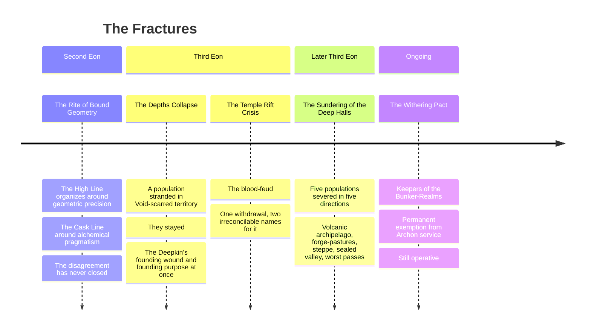

![[Assets/Paintings/dawi.webp]]

# The Marrowkin

**Say it** · MARE-oh-kin. In their own tongue *Ytinkreis*, the hearth-line of the marrow.

*Eight Answers to One Endurance · One Debt · Revised Codex*
> *"Varūn did not make us strong. He made us the thing still standing after strength finished arguing with itself."*
>
> *Marrowkin saying, lineage of origin disputed by all eight branches equally*

The worst wedding in the history of Kegshard Hold took place in 431 IC, and the guests still rate the ale. Aino, daughter of the rune-forger Kalervo Straightedge of the High Line, was marrying a Cask Line cooper's son, the first such match in four generations, and Grand Brewmaster Ulla Sevenhoop had spent ninety years on the wedding cask: a tun the height of three Marrowkin, barley gold and amber through its glass bung, sung to every morning of those ninety years in the Old Alchemic Song so that the liquor inside had learned the tune. Master Kalervo walked in on the morning of the feast, in his good iron rings, and looked at it. He observed that the hoops ran a hair out of true. He observed this several times. And when Ulla had gone up to dress, he took out a chisel, because he loved his daughter, and cut one small correcting rune into the top hoop, so that the vessel would at last be correct.

A thing that has been patiently becoming something else for ninety years does not care to be told what it is. The rune said the cask was finished, and the ale, which had been promised another hour, disagreed. The hoops stayed perfect. The ale went out through the staves in a roaring gold column that carried off the head table, four tiers of honey-cakes and the Hold's second-best organ of brass pipes, and the foam kept rising, singing its own wedding song in a key that loosened teeth, up the great stair, through three levels of Kegshard, while Kalervo cut more runes into the walls ahead of it, faster and faster, each one making the geometry truer and the pressure worse, and Ulla Sevenhoop stood in the flood in her bride-mother's braids singing at it to calm down, with her beard on fire from somewhere. It stopped at the fourth landing. At the fourth landing a guest nobody had invited was standing with a mug, a gray, quiet person from a long way down, and the foam reached his boots and died, along with the torches, the singing, the glow in every rune on the wall and the feeling in Kalervo's left hand. Two hundred people stood chin-deep in the finest ale anyone has ever tasted, in the dark, with a Deepkin in the middle of them. He finished his drink and went back down. The wedding roll lists him as *a Deepkin*, and the High Line and the Cask Line have been sending each other the bill ever since.

There you have Varūn's three faces at one party: the geometry, the fermentation and the threshold. There you also have a hold of people four feet tall with fire behind their eyes, standing in a gallery cut through the bone of something the size of a province. Both accounts take longer than the ale did.

The Marrowkin are the people who live inside a dead god and sell pieces of it. They are smiths by trade, clerks by faith, and debtors by birth, and the older rolls and most of the songs call them the Dawi, the name they carried before the Body finished with them. The realm is [[Geography & the Four Quarters/The Bearing and the Holding/The Inner World — The Northern Shield/The Ember Holds of Marrowhold|the Ember Holds of Marrowhold]]; this page is the people.

---

## What the Body Did to Them

Nobody goes on drinking what runs through that bone for as many generations as this without paying for it. Their water comes off the ribs warm and iron-tasting, their walls give off heat, their children take a smear of marrow at the First Entry, and the Ring has been altering them for longer than the Guild's count can follow. Here is what you will notice, in the order you will notice it.

**The eyes.** They are large, set wide, amber through furnace orange to the red of a coal, with a bright layer at the back that throws lamplight back at you the way a cat's does. A gallery full of Marrowkin at shift-change is a dark full of paired sparks. Open daylight hurts them. Out of doors they wear **slit visors**, a band of carved horn or ivory with one narrow cut across the eyes, and a clan's visors are as recognizable as its banner. A Marrowkin who takes off his visor to look at you in the sun is paying for the privilege and would like you to know it.

**The heat.** Their blood runs hot and dark, the color of old rust, and in a cut it shows a dull glow in a dark room. Snow melts on them. They steam on a northern morning, a handshake feels like a loaf from the oven, and across nose and cheekbones they carry a deep **forge-flush** they are born with and then bake in. A long winter away from the Ring brings on a gray, shaking cold-sickness that ordinary fires do not touch, and the cure is to go home.

**The bone.** They stand about chest high to a human, as wide as a door, and weigh twice what they look. A Marrowkin cannot swim, sinks like an anvil, and regards rivers as a matter for other people. From about the thirtieth year **the rise** begins: ivory-colored ridges of new bone push up through the skin along the knuckles, the brow, the collarbones and the outer forearm, in both sexes, and go on growing for life. Their skin has a grain in it, warm ivory to dark amber, like old tusk with a lamp behind it.

**The record on the bone.** The Soul-Rune practice is cut into the rise. **An elder's body is a reading of their life**, the entries in the Tally register, accumulating and impossible to revise, so that an old rune-forger's forearm is effectively a bracer with a biography on it.

**The beard.** Both sexes grow one, starting ash-white and yellowing over decades toward the color of the ribs, untrimmed, ringed with etched iron or copper that records time served, and frequently singed. A bare-jawed adult is a scandal or a recent accident.

**The sound.** Their chests are built like rooms. A Marrowkin voice comes with an under-note, a second tone lower than the word, which you feel in the breastbone before you are sure you have heard it, and in formal speech, when the meter runs, a clerk's reading can be followed through the floor from the next gallery. They speak low and flat and they do not raise their pitch to make a point, because their tongue does not work that way. They also hear through bone. A Marrowkin with a jaw-ridge laid against a rib can follow a conversation a long way off and tell you which chain is about to go. They can talk this way too, in a tapped code on the wall that every child learns before the alphabet. When one of them goes quiet and leans a cheek on your doorpost, you should stop talking.

**The smell.** Hot iron, tallow smoke, sulfur and yeast, from across a market.

Dress runs to soot-black leather, copper hoop-bracelets, red-dyed wool in a shade nobody else can get, and work aprons kept as carefully as other peoples keep court robes. They are a loud people about one subject: put a Marrowkin in front of a good seam or a clean pour and the flat voice goes, the fists go up and the whole shift hears about it in meter. About everything else they will tell you the figure.

---

## The Debt

**Everything in Marrowkin life is downstream of three facts:** they have been cutting pieces off something enormous for longer than anyone can date, the language has no future tense, and a broken oath is audible in a name.

They do not worship the Body. They owe it. What it was stays disputed among scholars and is a matter the holds refuse to enter; they call it the Body when they are selling and *Lainur*, the Lender, when they are frightened. The account runs from the first cut, each person's take is entered under their name, every sale closes with a clause making the piece returnable on the Lender's demand, and each death pays something back: **the dead are returned**, walled into a cut gallery in the bone their line has worked, the only ground a Marrowkin will accept. A hold's roll of the dead is cut beside them. It is read aloud on the Drawing-Off with the balance after it, and the balance has never once gone down.

Why they keep it, when no creditor has ever called, is the one question you will get a straight answer to. Someday it will be asked for. They would like to be able to say who took what.

### The faith that is not one

**Never previously named as a religion, including by the Marrowkin, who would deny it is one.**

**Claim.** That an act either happened or did not, that the record is the world's memory of it, and that the record is sacred because nothing else is durable. They keep the Tally, and by their own reckoning they have kept it for six thousand years, a figure the Guild's Errata would cut down hard and which no clerk has yet dared carry to a hold. The entering is itself an act that gets entered.

**Daily.** The entry. Every completed lawful act, in fixed wording, scanned to Mathematical Cadence, because a statement that does not scan has not been entered whatever it says. **Clergy.** The clerks, and they eat by the hold. A Marrowkin would say these are administrators, and every other people in the four quarters, shown a caste of hereditary record-keepers using a fixed liturgical meter to enter acts into a book that has never been closed, would say something else.

**Heresies.** The unentered act, *kurnur*. The broken oath, which counts as a change of grade rather than a sin, audible in the name, permanent, and published on a wall. And the deepest one, the Deepkin's Mirror-Sign, the only language of the people in which a broken oath does not announce itself. **Cost.** The future tense, as the grammar explains at length. **Wrong about.** That the record is the world's memory. A record can be destroyed with an axe, as the Keth-Gorrum's has been, and a faith built on permanence has no doctrine for the hole.

The word they swear by is older than the debt. **Varūn the Deepwright** taught that the universe requires endurance, not strength, and everything in the Fractures below is an argument about what he meant. The holds refuse to say what Varūn and the Body have to do with each other, and the refusal is entered.

---

## Names

The full account is in [[Races & Peoples/The Tongues of the Realms/The Grammars/The Tally-Tongue of the Marrowkin]]. A Marrowkin carries four names and earns two of them.

| Slot | What it is | Example |
|---|---|---|
| **Given name** | Two elements from a fixed inventory, conferred at the First Entry around the seventh year; a smaller child is called by birth-shift and count | *Vappu*, *Mirja*, *Hettrun*, *Oskrin*, *Ulvi* |
| **Oath-name** | Second place, conferred at oath-taking, spoken in the strong grade while the oath stands and the weak grade once it has broken | *Tarrekk* / *Tarre*, *Kaltekk* / *Kalte* |
| **Line** | Hearth-line or parent, in the genitive | *Ollan*, *Sarnan*, *Vanhanan* |
| **Cut-name** | The largest single thing you ever took from the Body, by weight or by part, and everyone uses it | *Sixty Tuns*, *Half a Rib*, *Thimble* |

The cut-name is the only boast in the four quarters that is also a confession. It goes on the roll when you die, and your line inherits the debt beneath it and has to find a name of its own.

---

## One Architecture, Three Original Pressures

The people were made from one thing: **Varūn the Deepwright's understanding that the universe requires endurance, not strength.**

| Lineage | Varūn's face | Origin |
|---|---|---|
| **The High Line** | His **geometry** | The Rite of Bound Geometry, Second Eon: structure as the ground of reality |
| **The Cask Line** | His **fermentation** | The Subterranean Crucibles, Second Eon: patience as transformation over time |
| **Deepkin** | His **threshold** | The Third Eon's Depths Collapse: the principle of endurance stripped to its minimum and found, against all expectation, to still be standing |

These three held the deep halls, the oldest galleries under the basin floor, for the whole of the people's recorded history. **What happened afterward is why there are eight lineages now instead of three.**

---

## The Fractures

Each fracture is still operating. **To understand current Marrowkin politics, read them as ongoing conditions, and never let a clerk hear you call them ancient history.**

### The Rite of Bound Geometry · First Divergence

**It began without hostility.** Varūn's two primary aspects were understood as complementary by practitioners close to the original teaching, and as competing by those who needed to govern populations. High Line communities organized around geometric precision; Cask Line communities around alchemical pragmatism.
> The disagreement about which was truer to Varūn's nature has been running ever since and has never produced a resolution, **because both positions are correct and neither side is willing to say so.**

### The Depths Collapse · Second Divergence

A catastrophic failure deep beneath the Innerworld's foundations left a population stranded in Void-scarred territory with **no way back to the lit halls.**

They did more than survive it. **They stayed, and have guarded the collapsed zones ever since**, uncredited by most formal Accord record. This is the Deepkin's founding wound and their founding purpose at once.

### The Temple Rift Crisis · The Blood-Feud

> The **High Line record** describes a strategic withdrawal from an untenable position during a Void-incursion into collapsed temple zones.
>
> The **Deepkin record**, maintained in Mirror-Sign and not translated for outside eyes, describes what the Deepkin experienced on the other side of that withdrawal: **being left alone with the Void while the people who shared their teacher and their bloodline left.**
>
> The Deepkin held the collapsed zones. They have been holding them since. The distinction between *the High Line withdrew* and *the Deepkin were abandoned* has never been formally adjudicated.
>
> **The blood-feud is the Deepkin's position on who gets to name what happened.**

### The Sundering of the Deep Halls · Third Divergence

A separate, subsequent collapse, **the exact trigger still disputed** between what the surviving branches' oral records claim and what the High Line archives admit to, severed five further populations from the tunnel-network entirely, in five different directions, stranding each in terrain that shared nothing with the interior of the Body.

**None of the five could simply wait to be rescued.** Each rebuilt Varūn's teaching from the ground up, in whatever shape the new ground demanded. Out of the heat and the bone for generations, they have drifted further from the people in the Ring than the Ring's people care to admit: cooler hands, duller eyes, and a habit of being surprised by the bill.

### The Withering Pact · The Cask Line Withdrawal

When the Archons made their claim on the people's service, the High Line's refusal produced confrontation that ended in autonomous status. The Cask Line's refusal produced **the Withering Pact**, an agreement in which they accepted the designation of **Keepers of the Bunker-Realms** in exchange for permanent exemption from Archon service.
> The Pact is still operative. The vaults are still maintained. **The contents of those vaults are the primary reason external powers treat the Cask Line with considerably more diplomatic care than their surface-level political profile would otherwise warrant.** Kings who would not cross a street for a brewer have crossed whole provinces for this one.

---

## The Eight Answers

| Branch | Doctrine | Endurance means… |
|---|---|---|
| **The High Line** | Permanence as Truth | the correct structure never needing to change |
| **The Cask Line** | Transformation as Truth | patience applied to something that is allowed to change slowly, on its own schedule |
| **Deepkin** | Threshold as Truth | standing guard in the one place no one else can stand at all |
| **Kuntur Reach** | Verticality as Truth | claiming every elevation a body can reach as one territory |
| **Tallow Clans** | Season as Truth | moving between two homes so completely that neither one is ever truly left |
| **Windward Herds** | Motion as Truth | never needing a fixed place to still be whole |
| **Tower-Kin** | Debt as Truth | remembering exactly what is owed for as many generations as it takes to pay it |
| **Passwardens** | Passage as Truth | being the one fixed, trustworthy point in everyone else's movement |

Every branch talks about the shared arts in the same flat words, and they are the only people who do. A Marrowkin fighter with the aura coat up (the visible coat of their own color, which on most of them is some shade of furnace) is *on shift*. Pressure, the weight a strong soul lays on a room, is *the load*. Sensing another's Essence is *sounding you*, as a rock face is sounded for a bad seam, and it is as polite as it sounds. All of it goes in the Tally, and all eight branches will argue over who pays.

---

## The Three Deep Lineages

A note on terms for readers from the surface. **In the blood** names what a lineage's souls tend toward, a thing of blood and upbringing and never a lock; **Untrained lean** gives the tilt of the three layers before anyone has trained them, and never sets Mastered or Walked ([[The Magic System/The Soul and the Climb/The Three Paths Routing, Recognition and the Gate|The Three Paths]]); a **[[The Magic System/The Foundations/The Sixty Wellsprings/The Sixty Wellsprings|Wellspring]]** is one of the sixty types of Aether, each working on the Soul Crystal in its own way, and a lineage may be able to harmonize with it, or may reject it outright. **[[The Magic System/The Soul and the Climb/The Sixteen Stages|Stage]]** is a rung of the sixteen-step climb. A **Domain** is the territory in which a high-Stage practitioner's own law holds.

### The High Line: Rune-Forgers of the Bound Geometry

Varūn's geometric will given biological form, and the Ribs' own builders, who carved Breastbone's towers. **In their understanding, reality is order tolerating the illusion of chaos, and anyone who says it the other way round has simply measured badly.**

A High Line inscription has nothing decorative in it. It is the actual Aetheric vibration a concept is made of, rendered so exactly that **reality stops needing to be told what to do.**

**In the blood** · Geometric permanence, and pattern revealing structure

**Untrained lean** · Spirit 70% / Body 20% / Fate 10%

**Wellsprings** · Monolithion (primary), Judicium (strong secondary), Fixatio and Basilithe (accessible). **Rejects Nyxial, Tenebra and Nihiloth outright**: Geometric Cohesion is constitutionally antithetical to the void
> **Advantages** · The most corruption-resistant Crystal architecture in the Continuum; hostile intrusion shatters against its lattice the way glass shatters against stone.
>
> Geometric Domains where **lies leave measurable Aetheric residue**, with no punishment involved, because inaccurate description is structurally detectable.
>
> **Limitations** · **Stage VII Refraction is disproportionately hard** for this lineage: an architecture built to describe the world accurately struggles badly to turn that same precision on itself.
>
> **Geometric Lock** overgrowth risk: an overextended Domain can produce zones of absolute spatial permanence that trap the unwary before the practitioner even notices.

### The Cask Line: Alchemical Architects of Kegshard Hold

Where the High Line is Varūn's geometry, the Cask Line is his fermentation: **the understanding that some endurance is brewed, and stone does not get to be the only structure.**

Kegshard Hold's Deepvault, in the hollow of the Twelfth Rib, and the Great Cask-Oath are the same instinct in two forms: the conviction that **the most dangerous and the most precious things both deserve to be aged, watched, and never rushed.**

**In the blood** · Transformation through contradiction

**Untrained lean** · Body 85% / Fate 15%, **the only lean toward Fate in the Continuum to emerge from watching barrels rather than the sky**

**Wellsprings** · Basilithe (primary), Manganthra (strong secondary), Rebirthine (accessible, and uniquely so among the lineages, rot feeding what grows), Verdantia (accessible). Poorly compatible with Aurevane, Luminalis, and Judicium
> **Advantages** · **Alchemical aging**: their Crystal genuinely compounds potency the longer it holds Essence rather than spends it, so veterans outperform beginners in ways Level comparisons do not capture.
>
> The **Great Cask-Oath** makes their word structurally reliable, and socially reliable besides; breaking one costs the Crystal's own Coherence automatically.
>
> **Limitations** · **Spirit-Blindness.** Roughly **40%** of the Cask Line approaching Stage VIII without deliberate Spirit Path supplementation plateau or enter an unrecognized slow spiritual compression.

### Deepkin: Guardians of the Collapsed Zones

Varūn's threshold: **endurance reduced to its bare minimum and found to still hold.** Stranded by the Depths Collapse in Void-scarred territory nothing else can safely enter, they stayed, and have guarded it since, continuously, largely uncredited, **in a single paragraph of Third Eon Accord record that has never been updated.** Their heat has gone out. A Deepkin's eyes are the gray of cold slag, their rise has gone chalk white, and they stand in a Ring hold like a draft from a cellar.

Their names, in the Deepkin's own record, are kept in Mirror-Sign and **deliberately not transliterated for outside use.**

**Wellsprings** · Nihiloth (primary, native), a collapsed Basilithe (accessible), corrupted and collapsed Wellspring sites generally (primary access unique to this lineage). **Rejects Benediction, Oneirion and Aurevane outright**: 2× damage from Divine Light or Holy-frequency glyphs
> **Advantages** · **Aura Dead-Zone**: passive Aetheric suppression, +35% AoE resistance, reduced enemy technique efficiency in radius.
>
> **Dissonance Anchor**: passive Stage X zone stabilization within 15m, allowing others to work briefly in collapsed zones under their coverage.
>
> Total immunity to Madness and Spiritual Fragmentation; **100% efficiency Void-aspected access no other lineage safely approaches.**
>
> **Limitations** · **Psychological Void at Stage VIII**: roughly **30% risk of permanent Catatonic Stasis** on a failed Transcendence check without prior Soul-Caving preparation.
>
> The Aura Dead-Zone **plays no favorites.** It suppresses the Aetheric environment for allies as thoroughly as for enemies, complicating any collaboration with Wellspring-dependent partners. See the wedding, above.

---

## Languages of the Marrowkin

Their languages share one structural feature: **they are built for endurance rather than efficiency.** Each is physically adapted to what the lineage needs to survive. The grammar of the main tongue is on [[Races & Peoples/The Tongues of the Realms/The Grammars/The Tally-Tongue of the Marrowkin|its own page]], and the two facts every visitor should carry in are that every act in it has a doer at the front and the Tally slot at the back, and that nobody in it can say *I will*.

**Lattice Tongue · The High Line**

Less a separate language than **the foundational Parunic access level at which phonemes are Aetheric vibrations that constitute the concepts they represent, with nothing symbolic left in them.** The High Line does not translate from language to glyph; they produce the glyph directly through speech. Asking a High Line rune-forger to mind their language is therefore sound practical advice.

Outside practitioners who have attempted to learn it through immersion describe the experience as **learning to think geometrically rather than learning a new vocabulary.** Some succeed. Most find that the architecture required to produce Lattice Tongue phonemes correctly is not available to them without significant Crystal restructuring.

**The Tally-Tongue, Barkstone Dialect · The Cask Line and the holds**

The working language, with material-world resonance built into the phonemic structure. **Old Alchemic Song** is the tonal register used in brewing chants: it physically vibrates the liquids being crafted, producing a direct mechanical-acoustic effect on the alchemical substrate.

A Grand Brewmaster singing the Alchemic Song into a fermentation vessel produces measurably different results from a silence-brewed equivalent. **The Song is physical, the effect is real, and the priests may keep their theories.** Outside practitioners can reproduce it with sufficient practice and an adequately calibrated voice range, though they have to fake the under-note.

**Low Tally, the Hollow Dialect, and Mirror-Sign · Deepkin**

Their spoken language is produced by vocal cords that operate within the Aura Dead-Zone's dampening field. **Sound dies in their throats before achieving full resonance**, the plain physical consequence of their Void-fold architecture, and no affectation. The Hollow Dialect carries information in the quality of the sound-absence as much as in the sound itself, and trained Deepkin listeners read the hollow quality's variations as a secondary channel of meaning.

**Mirror-Sign is the primary operational language**: micro-reflections, hand gestures, and Entropic Vein micro-movements that communicate through reflected absence. It cannot be detected by standard Harmonics Attunement. It produces no Aetheric signature. **It is, in the most precise sense, undetectable by anyone who has not been taught to see it.**
>
> > *"You are still here."*
>
> Varūn the Deepwright's singular principle, expressed to each of his three peoples **in the specific language each of them needed to hear it in.**

---

## Moves, Costume and What Everyone Says

| Lineage | The move | The look | What they say about the others |
|---|---|---|---|
| **The High Line** | **Suora Viiva, the True Line:** a single rune spoken along the path of your blow, after which your blow may travel that line and no other | Iron rings, squared beards, a rule at the belt in place of a dagger, and they will measure you with it | "A Cask Line oath is good until the cask is empty" |
| **The Cask Line** | **Ninety-Year Pour:** the reserve they have been sitting on since their grandmother's day, let out all at once, gold and steaming, over you | Leather aprons, copper hoop-bracelets, a smell of malt from across the market | "The High Line has never once been drunk, and it has never once helped" |
| **Deepkin** | **You Are Still Here:** they walk up. Your coat goes out, your fire goes out, your [[The Magic System/The Soul and the Climb/The Trait System Law, Function and the Forge\|Trait]] stutters, and they are still walking | Gray on gray, no metal that rings, and no one has ever asked them to dance | They sign it. You will not see what they said, and it was about you |

Everyone else's opinion of the Marrowkin is a variation on one line, and it goes round every tavern from Hallenfeld to Sum-gol: lovely steel, read the bottom of the sale.

---

## Where the Registers Disagree

*Attested, not reconciled.*

**The parties to the Temple Rift Crisis.** The detailed record places the blood-feud between the **Deepkin and the High Line**, arising from a withdrawal from collapsed temple zones during a Void-incursion, and this account is reproduced above. A second register describes the Temple Rift Crisis instead as ongoing tension between the **High Line and the Cask Line**. Both cannot describe the same event. The Measurewrights note that only the first account names what the feud is actually about.

**The count of fractures.** One register lists three fracture events and omits the Depths Collapse and the Sundering. Another lists four and omits the Withering Pact. **All five are reproduced above**, on the reasoning that no register has withdrawn any of them.

**The count of branches.** An earlier framework describes seven branches, two deep lineages plus five surface, while the current codex describes eight, counting the Deepkin as a full branch rather than as an adjunct of the deep halls. **This register follows the eight.**

**The dwarves of Varūn.** The mountain kingdom of Varūn in the Old World keeps its own dwarves and sells veinwood at a fair price. The holds decline to say whether those are cousins, and the kingdom declines to say anything. **Unreconciled.**

---

> *"Eight ways to still be standing, and Varūn has never once told any of us which one he actually meant."*
>
> *Attributed to a joint Kegshard–Qori Anka trade summit, exact speaker disputed*
