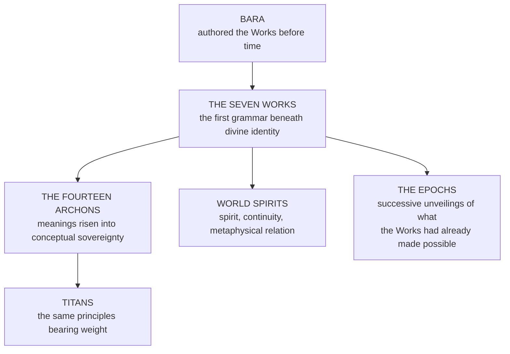

![[Assets/Paintings/hero.webp]]

# Hataraki — The Works of the Plane of Fate

At the midsummer brackets at Tobishima, in front of nine thousand people and with his family banners going up behind him on three poles, Moto Naoki, aged twenty-two and very pleased about it, faced the great new gate of the Guild lists and pronounced collapse upon it in a voice you could hear over the rice sellers. *Hōkai Senkoku!* The gate stood. It was a good gate. He said it again, with his aura up around him like a white bonfire, and the gate went on standing, and nine thousand people began slowly and happily to explain to him what they thought of it. His aunt, Moto Kiyo, who had come only to fetch him home for a funeral, had been sitting since dawn on an upturned basket at the foot of the lists with a stick of rice cake going cold in her hand and her eyes on the visitors' stand behind him, which had been put up in a hurry by a carpenter who owed money. She had not taken a bite. When the crowd was at its loudest she went very still, with her breath held on a count that was not the crowd's, and the air around that stand turned slightly too tidy, and she said the same two words so quietly that only the rice seller heard. The stand folded along every joint it had been lying about, one neat bay at a time, and set four hundred shouting people down on the grass with hardly a broken ankle among them. What that stand had been going to do in the second week of the brackets, with a full house and the wind behind it, the Guild's surveyors afterward drew for the coroner and did not publish. Kiyo sat where she was with blood running from her nose and both eyes onto the rice cake. It took Naoki and a hired porter to get her to the cart, she did not speak until the second day on the road, and she had given thirty years and four generations of somebody else's grip to be able to do that perhaps twice in a good year. There are fighters who pay good coin to learn what she knew by then: the name is nothing, and the Plane of Fate takes no orders from anybody's lungs: it keeps a set of jobs, and some people can read them. Reading them is the easy half.

### HATARAKI (働き · Hataraki) (Work of the Plane of Fate; the inheritance of the Moto)
The world runs on jobs, and these people can tell a thing its job, or fire it.

HAMETSU NO GŌ! The Work of Ruins. What was already going to fall, falls now, in front of everyone.  
JUNKETSU NO GŌ! The Work of Purity. A thing is made to stand as it ought, and the stain has nowhere to stay.  
SEIREI NO GŌ! The Work of Spirit. The dead go where they are supposed to, and whoever stands in the road is moved.  
JIKAN NO SHIGOTO! The Work of Temporality. Something you did earlier arrives on time.  
CHISHIKI NO SHIGOTO! The Work of Knowledge. Your true name is read out, and you stop being able to pretend.  
BARANSU NO SHIGOTO! The Work of Balance. Whatever you overdid starts punishing you.  
ZENTAI-SEI NO HATARAKI! The Work of Totality. All of the above in one hand, and nobody should trust the hand.  

Nobody holds these seven the same way, and nobody holds them cheaply. Each is its own grip, handed down because no one has ever taken hold of Fate bare, and a real use of one can leave a veteran bleeding from the eyes with half of what they walked in with, and a job still undone.

The named arts of the house that carry these Works onto a battlefield live once, in the founder's own record, the [[The Disciplines/Schools and Bloodline Arts/Hataraki — The Works of the Plane of Fate/Hataraki no Sho — The Martial Application of the Works|Hataraki no Sho]].

## How It Really Works

| **Path** | Fate, wherever a Work actually takes hold, and that hold reads Thread Class on top of whatever else is being paid. Blood gives no Path, so a Moto with a Work may lead on the Body or the Spirit road and read the blade on its own ladder |
|---|---|
| **Lens** | None required. A grip does not depend on a lens, and the lists under each Work below show only what a Moto of that Work tends to temper on |
| **Form** | Pull |
| **Gates** | The inherited grip itself, then Dominion Fate against the target's Persistence and Continuity |

On a card it takes one line, and it is no Trait, technique, blessing or Class: `Fate Art: Ruin · grip · Thread I`.

*Hataraki, literally translated as Work, is the governing function of the Plane of Fate.*
> It is the labor by which existence is maintained, classified, corrected, and moved toward its appointed outcome, well beyond any form of magic or source of power. Where other systems channel force, **Hataraki administers purpose.**

---

## Overview

In this framework, the Plane of Fate is an active plane of order, motion, judgment, and unfolding design, and no passive realm where destinies drift. Hataraki is the operative current running through that plane. Through it, ruin destroys when destruction is required, purity establishes what must endure, spirit governs the traffic between life and death, temporality arranges sequence and history, knowledge reveals meaning, balance reconciles opposition, and totality gathers all functions into one complete law.

Each expression of Hataraki is called a **Work** because each one performs a necessary labor inside reality. A Work enacts its idea as a law-bearing process within the world, where a symbol would only stand for it.

### Origin

Before measured time, before chronology, and before the later unfolding of the [[Cosmology & Metaphysics/The Making of the World/The Three Epochs|epochs]], **Bara** created the Works of the World within the Plane of Fate. These Works were made as primal functions and never as techniques or schools of sorcery: the first operative laws by which existence could act, divide, endure, unravel, and complete itself.

For this reason the Works are older than history and older than sequence. Even time itself is not prior to them, because temporality is only one Work within the larger order of Hataraki. The Plane of Fate therefore stands as **the chamber of function before event**, the unseen order beneath becoming, where reality is not yet merely happening, but being assigned its labor.

### The Three Levels

Hataraki operates on three levels at once.

| **Conceptual** | It defines what a thing means within the order of existence. |
|---|---|
| **Operational** | It determines what that thing does and how it affects reality. |
| **Judicial** | It determines when that function is permitted, necessary, excessive, or forbidden. |

Under this model, **fate is labor**, and blind prediction has no part in it. It is the continuous work of assigning, preserving, undoing, measuring, and completing the roles of all things.

---

## The Works, the Archons, and Higher Being

The Archons exist as sovereign intelligences of conceptual law, but the Works are more basic than Archonic personhood. The Archons exist because these meanings rose into conceptual sovereignty; the Works represent what those meanings are at their most stripped-down and fundamental level.
> If an **Archon** is a crowned idea, then a **Work** is that idea at its first and barest function.
The Archons are not identical to the Works, nor do they replace them. The Works are more primordial. They are the first grammar beneath divine identity, the raw operative meanings from which higher law could later become conscious, named, enthroned, and cosmically administered. The Archons embody, judge, and exalt meanings already latent within the Works.

This also explains the existence of World Spirits and Titans. Such beings do not arise in a void. World Spirits can exist because Spirit, continuity, and metaphysical relation already function. Titans can exist because structure, force, collapse, world-law, and embodied principle were already written into reality by the Works. **The Works are the precondition for those greater beings to manifest at all.**

---

## Seven Grips, and Why It Is So Hard

A fair question from the Guild's first-years is why there should be seven Works, when one would be tidier. The answer is that a Work is a handle, which is a different thing from a spell or a skill.

Fate sits above the two lower realities. Physical Reality and Spiritual Reality are places a person can stand in and push on. The thing the Guild calls the Plane of Fate, as a courtesy, is everything that flows: every possibility, idea and concept, what has to be so before anything can happen, and the law and construction of the world itself. There is nothing up there to brace a foot against, and worse, there is nothing in a person to brace with. **Everything you understand is made of the thing you are trying to move.** Your notions of cause, of likely, of what a blow is, all came out of Fate, and they cannot be reasoned into a tool to use against it. Measurewrights have described threads for whole careers and never lifted one. Drill does not help. Nobody has ever gripped it bare.

**So each Work is one distinct, inherited way of taking hold of one function, and that is what makes the Moto so deadly.** Bara's line did not learn Fate. It was handed seven handles, and it has spent every generation since getting its children's hands to close on them.

| Work | What the grip closes on | What it will not close on |
|---|---|---|
| **Ruin** | What is already failing, at the seam where it fails | Anything sound. Moto Naoki's gate is the standard lesson |
| **Purity** | What ought to stand, and the stain on it | A thing with no rightful form to be restored to |
| **Spirit** | The crossing between life and death, and whoever stands in it | The living who are not in the road and have nothing owed there |
| **Temporality** | What was done earlier and is due now | A debt of sequence that was never run up |
| **Knowledge** | What a thing is, under its name | A thing that is exactly what it says it is, which is why the honest sleep well |
| **Balance** | An excess already running, turned on the one running it | Anyone not overdoing anything |
| **Totality** | All of the above, in one hand | Very little, which is why the founder himself would not trust the hand |

The grips do not trade. A hand trained to Ruin is no use on a Purity job, any more than tongs are a ladle, and an old Moto who can bring down a citadel along its worst joint may stand over a poisoned child unable to do a thing about it but send for an aunt. Most of the house live and die with one Work truly theirs and the rest known by rote, and that is the honest reason for the [[The Disciplines/Schools and Bloodline Arts/Hataraki — The Works of the Plane of Fate/Hataraki no Sho — The Martial Application of the Works|Sho's]] seven lines and its long list of arts that a house full of specialists has to carry between them.

### What it costs to use one

The blood gives the grip and nothing else. A Moto's [[The Magic System/The Soul and the Climb/Classes and the Three Ladders|Thread Class]], the ladder that measures how much of Fate a soul can pull down and hold, may open before Glory where almost anyone else's would never open at all, and it is still the steepest of the three ladders, with worse returns on every rung than the other two. Blood opens that ladder early and the cap never lifts. Nothing about being born to it makes the pull light.

- **Most of the time they do not pull.** What a Moto does in most fights is read, and then hit: the Shingan finds the seam, the sword goes in at the seam, and no thread has been touched. Blood gives no Path, and most of the house lead on some other road. A Moto who has also walked the Fate Path adds its Range, its Aura Pressure and its presence, and that is a very frightening fighter who has not yet done anything difficult. The rest get what any Body or Spirit fighter gets, with a better eye.
- **A real pull low down** is one lean on the odds: a guard that slips, a strap that gives. It has a visible charge and a tell, it can take a large share of the reserve, it leaves the body bleeding, and it often fails.
- **Higher up** a Work can remove or assign a prerequisite: this cut was always going to land, this wall was always going to fall. The price is ruinous at every Stage, and the distance from likely sets it.
- **It moves only what already has a way of happening.** A sound thing stands, as nine thousand people at Tobishima can confirm.
- **It can be refused.** Dominion's Fate Sub-Stat pushes, and the target's Persistence and Continuity push back.
- **It may belong to someone.** Most if not all of the [[Cosmology & Metaphysics/Faith and the Powers Above/The Fourteen Archons/The Fourteen Archons|Archons]] are Sovereign across all three planes, and up here they are the laws themselves. Uurgath and Urion are unparalleled in Fate. A thread pulled down may turn out to be somebody's, and it is possible to be noticed.

None of this makes the Moto the best fighters alive, whatever they say over dinner. A Work is slow to set against a straight exchange, and a Body Path veteran who reaches a Moto before the result arrives is hitting an ordinary body at its Stage. A Spirit fighter can see the pull on the Core before it lands and go for the hand on the thread. Another Fate user can lean the other way. [[The Magic System/The Soul and the Climb/The Three Paths Routing, Recognition and the Gate|The Paths page]] has the whole round of who beats whom, and the Moto have buried plenty of children who skipped it.

---

## Attraction Force and Obsession Force

No Work can endure as more than a passing occurrence unless existence recognizes it.

**Attraction Force** is the law of recognition, the binding principle that allows one presence to acknowledge another and for that acknowledgment to persist as continuity. Through it, vows remain binding, relics remember their bearers, lineages preserve their echo, Domains remain stable, and spiritual relations survive time, death, distance, and change. Within Hataraki, Attraction Force is what allows a Work to stay lawful, sustained, and recognized inside reality. A Work functioning through it binds through recognition rather than captivity, preserves continuity without erasing distinction, and remembers without devouring freedom.
> **Obsession Force** is the corrupted inversion. It arises when recognition loses mercy and release. Then connection imprisons where it once preserved. What was once lawful continuity becomes fixation, recursion, possession, and spiritual suffocation. Under Obsession Force a Work **clutches, repeats, saturates, and narrows until its function becomes a cage.**
Every Work therefore possesses both a lawful expression and a corruption vector.

---

## The Seven Works

> The Works do not replace the canonical Sixty Wellsprings. Each Work gathers, administers, and gives higher functional direction to clusters of Wellspring law. **A Work's grip does not depend on a lens.** The lists below are what a Moto of that Work tends to temper on, and a single Wellspring may lean toward more than one Work depending on context, rite, and metaphysical use. The Fate and Medium names come first because those are at home on the road the Works live on; a Moto of Ruin who leads on the Body road and tempers on Fractura closes the same grip on the same seam.

### Hametsu no Gō · the Work of Ruins

The function of collapse, devastation, despair, madness, entropy, and the residue of chaos. It governs the necessary unmaking of corrupted, exhausted, or unsustainable structures. **Ruin carries no evil by default: it is the divine labor of ending what can no longer remain whole.**

Its function within the Plane of Fate is to break false continuities. When a kingdom, soul, law, pact, age, or structure has become diseased beyond repair, Hametsu no Gō performs the work of severance through destruction. It strips away delusion, tears down decayed order, and returns excess creation to ash, silence, or fragmentation. It is one of the oldest conditions by which reality is permitted to stop.

**Common functions** · Dissolution of corrupted structures · acceleration of collapse where rot has already begun · infliction of despair, insanity, or existential pressure · exposure of instability hidden beneath beauty, power, or sanctity · reduction of excess order into raw aftermath · discharge of a blessing that has become a false continuity.

**Through Attraction Force** · lawful ending, necessary severance, corrective destruction. **Through Obsession Force** · recursive annihilation, compulsive devastation, fixation upon collapse for its own sake.

**What a Moto of this Work tends to temper on** · Tarturon · Oblivara · Mortalis · Cataclysm · Fractura · Nihiloth · Cinerion · Exuroth

### Junketsu no Gō · the Work of Purity

The function of foundation, creation, order, clarity, sanctity, and sacred sanity. The stabilizing labor that establishes what ought to stand, what ought to be protected, and what ought to remain uncontaminated by corruption.

Its role goes past healing: it exists to **define proper structure**. Purity creates sound foundations, restores rightful form, and enforces integrity upon matter, law, spirit, and intention. Where Ruin strips away what has failed, Purity builds and preserves what is worthy of endurance. It is the primitive act by which existence becomes fit to remain.

**Common functions** · Construction of stable forms, laws, and sanctified structures · cleansing of corruption, distortion, or metaphysical stain · reinforcement of sanity, order, and inner coherence · illumination of truth through refinement · protection of sacred systems from defilement or breach · lifting a blessing that sits in the soul as a stain.

**Through Attraction Force** · consecration, restoration, rightful stability, sacred protection. **Through Obsession Force** · sterilization, fanatic correction, purgation without mercy, and the violent refusal of all stain or deviation.

**What a Moto of this Work tends to temper on** · Benediction · Fixatio · Aurevane · Luminalis · Judicium · Absolution · Redemption · Petralon

### Seirei no Gō · the Work of Spirit

The function of life, death, soul-traffic, communion, and metaphysical continuity. It governs the movement and condition of spiritual existence, including the transition between mortal life, death, afterlife, and any intermediary states between them.

Spirit does not only animate life; it regulates endings, hauntings, remembrance, reincorporation, severance from the flesh, and the weight of the dead upon the living. **It is the labor that keeps the unseen world from becoming disorderly**, and what makes spiritual existence administrable at all.

**Common functions** · Governance of life-force and soul integrity · passage between life, death, and posthumous states · communion with spirits, echoes, shades, and divine presences · regulation of necrotic imbalance, spiritual corruption, or soul-loss · maintenance of the boundary between the living and the dead.

**Through Attraction Force** · communion, ancestor echo, lawful death, soul continuity, sacred rebirth. **Through Obsession Force** · soul-hoarding, memory imprisonment, parasitic haunting, spiritual fixation that refuses release.

**What a Moto of this Work tends to temper on** · Mortalis · Anamnesis · Phreatis · Transference · Oblation · Anima Spirare · Letheveil · Contrition

### Jikan no Shigoto · the Work of Temporality

The function of time, sequence, duration, causality, space, history, and timeline management. It governs not only the passage of moments, but the lawful arrangement of events into coherent chains of before, during, and after.

Temporality ensures that existence unfolds in ordered progression. It maintains historical continuity, guards the relationship between cause and consequence, and stabilizes the architecture through which timelines branch, converge, repeat, or terminate. **Without this Work, reality would become chaotic and then unreadable.**

This Work is especially important because it proves that Hataraki precedes chronology. Time itself is one Work beneath the larger order of function established by Bara, and the Works owe it nothing.

**Common functions** · Regulation of time-flow, duration, and sequence · oversight of historical continuity and memory of events · structuring of timelines, branches, loops, and convergences · enforcement of causal consequence · alignment of spatial position with temporal order.

**Through Attraction Force** · preserved sequence, history, causality, meaningful progression. **Through Obsession Force** · loop-prison, recursive inevitability, frozen causality, and the inability of events to move beyond one wound, one vow, or one decisive moment.

**What a Moto of this Work tends to temper on** · Anamnesis · Somnalis · Phreatis · Tarturon · Transmutatio · Oneirion · Mirithane · Lethegraal

### Chishiki no Shigoto · the Work of Knowledge

The function of understanding, revelation, perception, liberty of thought, interpretation, and meaningful cognition. **The labor that permits reality to be known rather than merely suffered.**

Knowledge gives shape to comprehension. It governs learning, memory, discernment, discovery, and the power to correctly interpret the laws of existence. It also has a liberating aspect, because knowledge breaks imprisonment by ignorance, false naming, and imposed blindness. It is the primitive permission for truth to become intelligible.

**Common functions** · Revelation of hidden truths, names, patterns, and laws · expansion of intellect, memory, and interpretive power · liberation from deception, ignorance, and imposed limitation · clarification of symbols, histories, and divine mechanisms · recognition of the proper meaning or use of a thing · reading a blessing's line for what it is, giver and terms.

**Through Attraction Force** · revelation, teaching, inheritance of truth, lawful interpretation, lucid understanding. **Through Obsession Force** · fixation, devouring certainty, interpretive mania, enslavement to one consuming idea or forbidden truth.

**What a Moto of this Work tends to temper on** · Luminalis · Aurevane · Anamnesis · Phreatis · Oblivara · Judicium · Mirithane · Eidolyn

### Baransu no Shigoto · the Work of Balance

The function of reconciliation, measure, proportion, unity, and reason between opposites. **The labor that prevents dualities from destroying the world through unchecked excess.**

Balance governs the tension between Ruin and Purity, death and life, law and freedom, creation and destruction, motion and stillness. It leaves opposition standing and assigns proper weight to each force so that existence can endure strain without tearing itself apart. It is the first mediation.

**Common functions** · Mediation between opposing principles · restoration of measure when one force becomes excessive · harmonization of conflicting laws, systems, or essences · preservation of unity without requiring sameness · establishment of reasoned equilibrium in unstable conditions.

**Through Attraction Force** · harmony, lawful arbitration, coexistence, measured equilibrium. **Through Obsession Force** · suffocating stasis, forced symmetry, paralysis in the name of fairness, and the refusal to permit necessary imbalance where reality requires it.

**What a Moto of this Work tends to temper on** · Transference · Oblation · Tarturon · Fixatio · Coagula · Thaloré · Basilithe · Petralon

### Zentai-sei no Hataraki · the Work of Totality

The highest and widest expression of Hataraki. The function of wholeness, integration, reality-completion, and the convergence of all subordinate Works into one governing total system.
> Totality stands above the other branches as the **crown-function** that contains, coordinates, and gives context to every Work beneath it. If Ruin ends, Purity builds, Spirit transfers, Temporality orders, Knowledge reveals, and Balance reconciles, then Totality is what makes all of those functions belong to the same universe without contradiction.
>
> It is the first permission for reality to be **one** reality rather than a shattered multitude of unconnected processes.
**Common functions** · Integration of all Works into a single coherent order · oversight of reality as a complete functional system · governance of existential wholeness and cosmic relation · resolution of conflicts that exceed the authority of any single Work · manifestation of Hataraki in its most complete and universal state.

**Through Attraction Force** · coherence, relation, cosmic unity, lawful integration. **Through Obsession Force** · total dominion, subsumation, enforced oneness, and the hunger to gather all distinctions into one captive frame.

**What a Moto of this Work tends to temper on** · Fixatio · Benediction · Transference · Anamnesis · Materia Primordia · Transmutatio · Monolithion · Abyntheus

---

## The Functional Relationship Between the Works

The Works are interdependent functions inside a single greater order.

| Work | Its labor in one line |
|---|---|
| **Ruin** | clears what must end |
| **Purity** | establishes what must remain |
| **Spirit** | governs what must pass between states of being |
| **Temporality** | arranges when and how things unfold |
| **Knowledge** | reveals what things are and how they may be understood |
| **Balance** | prevents opposition from becoming annihilating excess |
| **Totality** | gathers every Work into one complete architecture |

Together these Works transform the Plane of Fate from a realm of simple prophecy into a realm of **active divine administration**. Through Hataraki, Fate performs the work necessary to produce, preserve, alter, terminate, and complete those outcomes.

### Taking a blessing off

A real Fate Art can do to a blessing what almost nothing else can, whoever gave it, and it is the reason people run when a Moto starts reading their thumb. A blessing, to a Moto, is a job someone has assigned to the odds, and a job can be read, and a worker can be fired. Three Works do it, in three motions, and since the grips do not trade it takes two Works or two Moto to do it at all. **Knowledge** reads the line for what it is. The remover then names aloud what job the thing was given and by whom, because Hataraki administers purpose and has to say what the purpose was. **Ruin** then breaks a line that has become a false continuity, or **Purity** makes a thing stand as it ought until a line sitting in the soul as a stain has nowhere to stay; a true gift, well held for decades, offers neither handle and takes days. To *take back* returns a line to its author, who feels it arrive. To *remove* ends it where it stands. Either way, everything standing on the line comes down at once. What falls and what it costs the remover are set out in [[The Magic System/Practice and Institution/Blessings and Curses|Blessings and Curses]].

---

## Hataraki at War

People who have read the Works as doctrine and never stood near a Moto host expect lightning. What they get is a bad week. The bridge they were counting on has a rotten pile. A general's gray throws a shoe on the one morning it matters. The wind comes round in the hour the archers loose. By noon an army that has not yet lost a single fight is running exactly where somebody under a plain banner spent two days arranging for it to run, and that person, as at [[The Magic System/The Soul and the Climb/The Three Paths Routing, Recognition and the Gate|Akagawa]], is being carried off the field by four others.

**Moving a whole field is a life's masterwork at high Stage or a bloodline's art, and the Moto are the bloodline.** Even for them it may be done once in a war, and it may cost the person who does it everything they have left. A Moto host is built around that fact. Its generals, the Khökh-ke above all, rank a field the way other children learn sums, and they spend the whole campaign on reading, marching and banners, so that when the one pull comes it needs to move as little as possible. An army is thousands of straps wearing at once, and the art is in waiting until most of them have already nearly gone.

| Work | Its office in a war |
|---|---|
| **Ruin** | The rotten pile, the undermined wall, the alliance a season from collapse, brought down in the hour that suits |
| **Purity** | Your own host: oaths kept, camp fever and curses held off, the line that does not break because it has been made to stand as it ought |
| **Spirit** | The dead of the last battle, who do not rise for the enemy, and the enemy's revenants, who stop |
| **Temporality** | Who arrives when. The relief column that is two hours late, and the feint made in spring that opens the door in autumn |
| **Knowledge** | Which of their captains is lying, which of their Fate users is real, and what their general thinks his own plan is |
| **Balance** | The excess every army runs on. A host that has overreached is tilted until its own reach undoes it |
| **Totality** | Attested at the end of wars and at the ends of Moto. The house does not plan on it |

**Each side's first job is to find the other's Fate users**, ahead of even their champions, and a Moto host's own are hidden accordingly, in plain hemp under no banner, with a very good bodyguard who has been told nothing. A well-kept army with sound gear, fresh horses and no bad habits gives them little to work with, which is why a war against the Moto is won or lost in the quartermaster's tent as often as on the field, and why nobody who has fought them ever again buys cheap harness.

---

## The Works, the Glyphs and the Loom

A Work is a grip and never a glyph, and the two are confused about once a season by people who ought to know better. A glyph is a path across the Parun lattice (the fixed grid of the root script of law), a reading taken from one of the fourteen stations the Archons hold, and it limits what a Wellspring's idea is doing. A Work traces no path, fills no slot and adds up to nothing. It is one of the functions Bara wrote into the Plane of Fate, with a way of taking hold of it handed down.

**The Loom of Stars is that same lattice seen from above.** The Archons read it from their stations. The Moto read by delegated sight, from the Loom, the Kōkan Line having administered it under leave from above the stations. So the Shingan and a cut glyph are looking at one object from two very different chairs. This is why the Counted Speech has no Warrant word for what the house holds: a word's value is a sum of cells, and cells are what the stations read, so the record writes down the sound a Moto speaker opens on and leaves the value blank.

Nothing about this makes a Moto a better cutter. A Moto who speaks or cuts a sentence spends the soul's own share like anyone else, and glyphs and Seals never pull. The two meet at one place only. A Fourth Seal does not wait for a line to end but ends it, which is past what any soul's own share will buy, so it needs a grip on Fate or a Warrant that carries one. [[The Magic System/The Foundations/The Master Glyph Index — 136 Attested Forms|The Master Glyph Index]] has the rest.

---

## Epochal Manifestation

Because the Works were created before time, they stand beneath the later sequence of epochs rather than arising from them. The Second Epoch and Third Epoch invent none of these functions. **They inherit and express them.**

This is part of the reason Aegor appears in the Second Epoch. His emergence is not the birth of those meanings, but a later historical manifestation of functions already authored in the Plane of Fate. In the same way, Ashura in the Third Epoch exists because the deeper functional lattice had already been laid before that age arrived. Each epoch comes after the one before it, but each unfolds on a foundation established long before chronology. In the days of the Physical Epochs Bara, Ashura and Aegor walked in human form, and the dead battlefields and relics of the Great Spirit War still answer to these Works.

The epochs are **successive unveilings of what the Works had already made possible**, and they replace nothing.

---

## The Second Roster: a Register of Doctrines

> [[The Magic System/Fracture of Worlds — The Living System/V. Wellsprings, Attraction and Obsession, Magic Integration (Parts Thirteen–Fifteen)|Fracture of Worlds]] preserves a differently-named set of seven, given with Sub-Stat clusters rather than with functions, and only two names are common to both rosters. They are a register of practitioners' doctrines: seven ways of carrying a Work, each with the Sub-Stats it trains. There are seven Works and seven grips, and a list of how people have chosen to live with them is another kind of list.

| Doctrine, as the Fracture names it | Sub-Stat clusters | Character |
|---|---|---|
| **Zentai-sei no Hataraki** · Totality | Dominion (Sovereignty, Throne) · Tempering (Ceiling, Maturity) · Resilience (Persistence, Continuity) | The Work of wholeness and cosmic maintenance. Practitioners whose doctrine encompasses rather than excludes. |
| **Hametsu no Gō** · Ruins | Ardency (Flux, Overchannel, Cascade) · Resilience (Ward, Persistence) · Dominion (Pressure, Command) | The Work of necessary collapse. Practitioners whose doctrine dismantles what can no longer sustain itself. |
| **Unmei no Ori** · Fate’s Cage | Dominion (Fate, Command, Sovereignty) · Harmonics (Attunement, Axis) · Resilience (Oath, Continuity) | The Work of binding and consequence. Practitioners whose doctrine enforces the debts reality owes itself. |
| **Shinsei Naru Hikari** · Sacred Light | Harmonics (Attunement, Projection, Synergy) · Gnosis (Perception, Analysis) · Tempering (Clarity, Maturity) | The Work of illumination and purification. Practitioners whose doctrine reveals truth as a structural force. |
| **Eien no Yami** · Eternal Dark | Resilience (Persistence, Ward) · Harmonics (Stability, Suppression) · Dominion (Sovereignty, Sense) | The Work of negation and sovereign silence. Practitioners whose doctrine erases rather than creates. |
| **Saisei no Wa** · Cycle of Rebirth | Vitality (Regeneration, Constitution, Hemostasis) · Tempering (Maturity, Yield) · Harmonics (Synergy, Stability) | The Work of renewal. Practitioners whose doctrine treats ending as the first motion of beginning. |
| **Chowa no Koe** · Voice of Harmony | Harmonics (Breadth, Synergy, Empathy, Attunement) · Dominion (Command, Sovereignty, Radius) · Gnosis (Fluency, Cognition) | The Work of concordance. Practitioners whose doctrine synchronizes rather than commands. |

---

## Final Definition

Hataraki is the active labor of the Plane of Fate. It is the system by which existence functions according to divine purpose. Every Work within it is a sacred operation: a law-bearing duty that sustains one necessary part of reality.

Bara created the Works before time. The Archons stand as higher sovereign expressions of meanings already present within them. World Spirits and Titans can exist because the Works first made such realities functionally possible. Attraction Force allows the Works to endure as lawful recognition and continuity, while Obsession Force corrupts those same labors into captivity and recursive need.
> To wield Hataraki is therefore **to invoke function**, and using power is the least of it. It is to call upon the labor of fate itself and command one of the fundamental works by which the world is kept in motion, judgment, structure, and completion.

Nobody who has done it has ever called it easy, and each Work is a separate hard thing to have learned.

**Cost.** A real pull takes a large share of the reserve at any Stage, leaves the body bleeding and often fails, and moving a field can cost everything the bearer has left. The Work presses the soul into a useful shape besides, and every Work carries a corruption vector: under Obsession Force, Ruin becomes compulsive devastation and Purity becomes sterilization, and the bearer does not notice.

**Counter.** A designation has to be earned, so be sound: a pronouncement laid on a thing with no hidden failure in it does nothing, and a false continuity is the only kind Ruin can break. Otherwise bring another Fate user to lean the other way, bind yourself too well to be moved, or reach the Moto before the result arrives.

**Numbers.** Seven Works, one grip apiece, gathered over the Sixty Wellsprings with the eight most often tempered on listed to each. Three levels of operation (Conceptual, Operational, Judicial). Fourteen Archons. The register of doctrines: seven names, two in common with the Works. No EU figures live here; the Works are priced at the art, and the arts are in the Sho.

- [[The Disciplines/Schools and Bloodline Arts/Hataraki — The Works of the Plane of Fate/Hataraki no Sho — The Martial Application of the Works]]

---

**Read next:** [[The Disciplines/Named Arts/Matla|Matla]] and [[The Disciplines/Schools and Bloodline Arts/Null-Light|Null-Light]], for the other two Epoch instruments; [[Cosmology & Metaphysics/The Making of the World/The Three Epochs|The Three Epochs]], for Bara; [[The Magic System/The Soul and the Climb/The Three Paths Routing, Recognition and the Gate|The Three Paths]], for Fate as a road anyone can walk.
